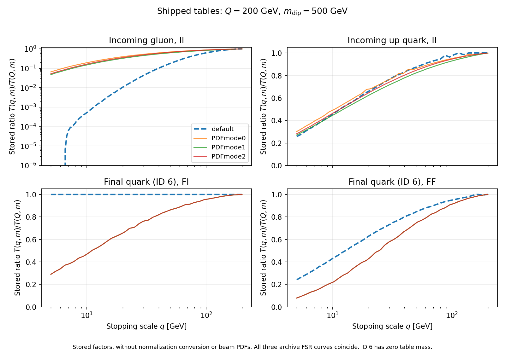
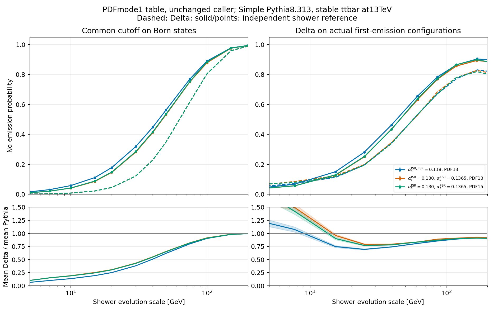
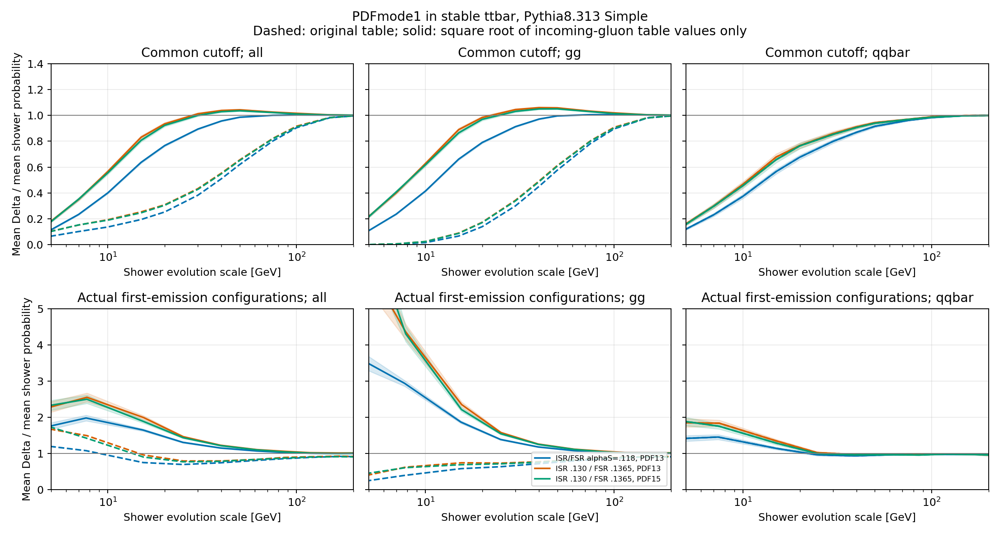
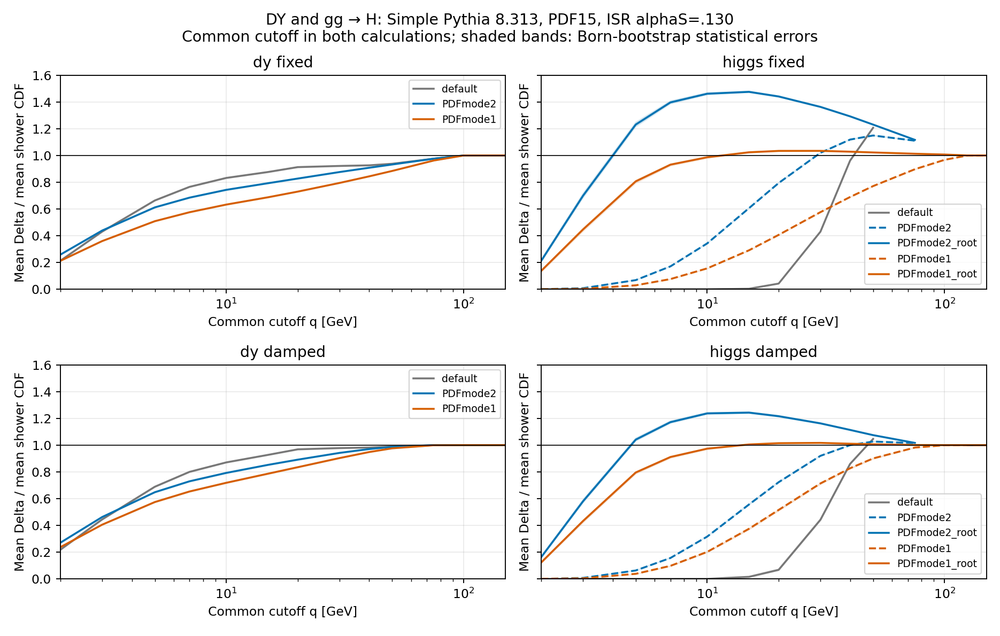
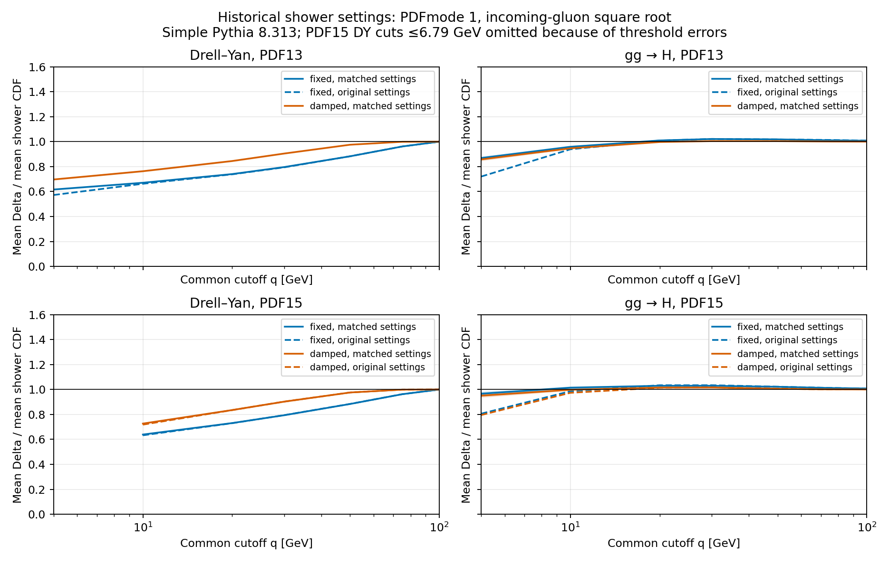
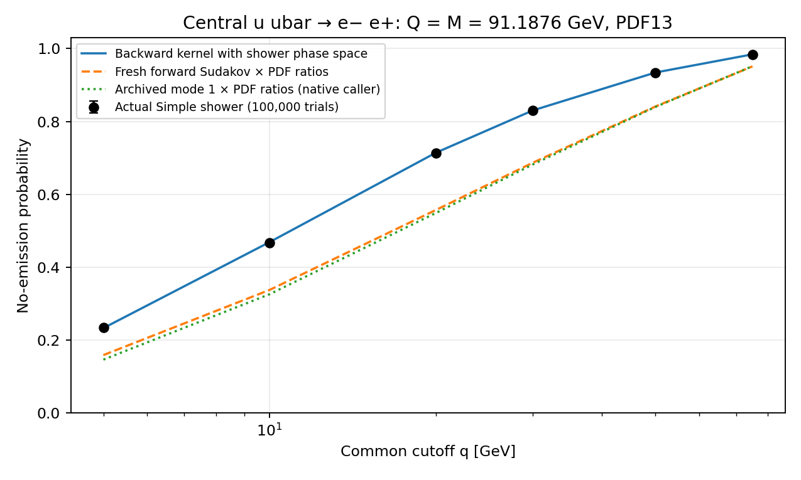

# MC@NLO Delta Sudakov table investigation

Consolidated findings from 27–28 October 2026. Repository branch: `MCcntRefactor_Sfun`. Investigated commit: `801a3417c98335f33894376df6e1005221ec53a6`.

The original default Sudakov table gives much smaller no-emission probabilities than the Simple Pythia shower for the tested top-pair sample. The archived PDFmode tables are substantially closer. PDFmode 1 matches the prescription selected in the MC@NLO-Delta paper, but substituting that archive without other changes still leaves an approximately 20% deficit in the 20–50 GeV first-emission region after matching the known historical coupling settings. Incoming gluons account for most of the remaining discrepancy.

The evidence identifies two distinct problems: anomalous content and old provenance in the original default table, and a mismatch between the full-radiator probabilities returned by the inspected generator APIs and the per-colour-line factors expected by the consumer. A separate numerical `0/0` edge case exists in the caller. Neither an ordinary change in alpha-s nor CMW rescaling explains the exceptionally small default gluon entries.

The explicit follow-up tests the distinction between **one gluon particle/dipole end in the table and its two colour lines in the code**. Applying a square root only to incoming-gluon mode-1 table values removes most of the common-cutoff gg discrepancy: with historical couplings and PDF15, the corrected gg ratios are 0.969, 1.031, 1.050 and 1.013 at 20, 30, 50 and 100 GeV. This supports the normalization diagnosis. It does not establish that this is the only difference from the shower: low-scale and quark-channel discrepancies remain. A further control shows that much of the apparent overshoot on actual emission configurations comes from comparing native unequal stopping scales with a scalar shower cutoff.

The Drell–Yan and gluon-fusion Higgs comparison has now been repeated with the recoverable historical generator settings, using Simple Pythia 8.313. With the historical default LO PDF13 and fixed starts, PDFmode 1 plus the incoming-gluon root gives Higgs table/shower ratios of 0.959, 1.010, 1.021 and 1.018 at 10, 20, 30 and 50 GeV. DY remains low: 0.671, 0.740, 0.796 and 0.883 at those cuts. Modes 0 and 2 are numerically closer for DY over those cuts, but considerably farther from the Higgs shower when the same gluon normalization is applied. No tested archive is uniformly closest across both processes. A subsequent kernel calculation and 100,000-shower central-DY control identify the dominant light-quark discrepancy: ordinary PDF evolution includes gluon-to-quark contributions outside the shower’s finite kinematic phase space. A fresh forward Sudakov multiplied by the PDF ratio retains that discrepancy.

The original singlet references retained ISR `pT0Ref=2` GeV and different quark-mass and azimuthal settings. The completed rerun removes these mismatches and supersedes the original setup for the matched-settings conclusions. It contains 2.4 million additional showers with PDF13 and PDF15. The historical producing-run log is still unavailable; “matched” refers to the contemporaneous generator source and recoverable defaults. The original top-pair samples have not been rerun with these additional settings corrections.

All numerical shower calculations used **Simple Pythia**, not Dire. References to Dire below concern historical source inspection only. The investigation initially left production unchanged. The accepted default update now selects PDFmode 1 and converts the raw API probabilities to individual directed-colour-line factors for all four dipole types; implementation and verification are recorded below. Plot/CSV labels named “default” refer to the original `sudakov_template.f`, retained for historical comparisons. The PDF-boundary correction remains a diagnostic prototype. The requested FKS settings were applied in the fresh process export used for the study.

## Scope and physics setup

The original question was how closely the branch's MC@NLO-Delta factor approximates the actual Pythia no-emission probability for top-pair production, as a function of the first-emission transverse-momentum scale. Subsequent checks addressed the table, its caller, coupling choices, normalization conventions, Git history, Pythia version, PDFmode definitions and the PDFmode 1 alternative.

The hard process was freshly generated as `p p > t t~ [QCD]`, using `loop_sm-no_b_mass`, proton beams at 13 TeV, stable tops with mass 173 GeV, fixed renormalization and factorization scales of 173 GeV, and the native `nn23nlo` PDF. Generation used seed 102701, 1,000 requested events, accuracy request 0.03 and four workers. Subprocess matrix-element/MC and pole checks passed; the reported integration result was 754.0 ± 4.1 pb. That integration result is setup provenance, not the observable tested here.

The fresh export used these settings in `FKS_params.dat`:

| Requested setting | Parameter | Value |
|---|---|---|
| sum-kl | `MCExplicitKLSum` | `.false.` |
| sum-ij | `FKSExplicitSum` | `.false.` |
| single colour flow | `MCSubtractionAtFixedFlow` | `.true.` |

The retained ensemble contains 871 S events: 785 with a gluon-gluon Born channel and 86 with a quark-antiquark channel. There are 55 negative-weight S events. All absolute weights are equal; the probability comparisons use the **absolute S-event measure**. They are not signed NLO cross sections.

Stored Born kinematics, colour flows, scalar starting scales and directed dipole starting-scale tags were preserved. For this top-pair sample, the scalar starting scale is sampled from the top transverse-mass reference over the damping interval 0.1–1 times that reference, with the native final-state dipole limits applied. Incoming shower-mass reshuffling in the LHE records was undone when reconstructing the hard quantities for Delta. Production grouped quark-flavour sums were retained, including representative positive/negative up-quark table IDs. Hard charm and bottom masses used by the stopping-scale reconstruction were zero.

The actual shower was Pythia 8.313 with its Simple shower. The baseline used ISR and FSR alpha-s at the Z mass equal to 0.118, one-loop running and CMW off. It used the original shower PDF13, NNPDF2.3 LO with PDF alpha-s label 0.130. The PDF15 control used NNPDF2.3 NLO with PDF alpha-s label 0.119. These PDF labels do not set the shower coupling.

The shower retained the branch's QCD matching settings: global recoil on, global recoil mode 2, one global recoil/branch, `limitPTmaxGlobal=on`, `pTmaxMatch=1`, scale fudge factors one, rapidity ordering off and matrix-element corrections off. QED showering, MPI, hadronization, primordial transverse momentum and top decays were disabled. Shower light-quark masses were 0.33, 0.33, 0.50, 1.5 and 4.8 GeV. Exact settings and process cards are retained in [cards](cards/).

## Meaning of the measured probability

For a fixed Born state B, including its colour flow and starting scales, define

    F_B(q) = Pr(pT_first <= q | B).

Here `pT_first` is the shower evolution scale of the **first accepted QCD branching**. It is not the laboratory transverse momentum of the emitted parton or of the top pair. A shower with no emission has `pT_first=0`. Thus F_B(q) is the probability of no emission harder than q.

For the primary baseline and the two new mode-1 samples, each Born state had 60 independent probe showers supplying actual first-emission configurations R and their scales q. A separate set of 240 reference showers estimated F_B(q). The original PDF15 control instead used 40 probes and 160 references; the ISR-only and FSR-only controls used 200 repetitions for their CDFs. The production Delta formula was evaluated on R and its shower Born preimage, using the branch's native real-dependent stopping scales. Delta(B,R) and F_B(q) were then binned on the same probe ensemble.

The reported ratio is the **ratio of the two binned means**, not the mean of event-by-event ratios. Errors come from 500 bootstrap resamples of the Born clusters, retaining all probes and references belonging to a Born together. Different bins are correlated. These errors describe statistical uncertainty, not the uncertainty of the physical approximation.

A separate **common-cutoff test** replaces every live stopping scale by the same q on each Born configuration, with soft-limit dipole masses. The production starting scales, PDFs, table calls, gluon combination and clipping are retained. This compares an equal-Born average with F_B(q); it is a different quantity from the average on actual first-emission configurations. The two tests must not be interchanged.

The study does not recompute the full FKS integrand or all alternative native-history Born maps. Equality between a history-dependent Delta factor and a one-dimensional shower CDF is not an exact theorem. The comparisons quantify the requested approximation; they do not by themselves establish a failure of NLO accuracy or predict final jet-distribution discrepancies.

## Full legs and factors for individual colour lines

A per-colour-line factor describes **one emitter along one directed connection**, denoted i|j. It does not include radiation from both ends of a physical colour connection.

Writing such a factor as S(i|j)=exp[-R(i|j)]:

- A quark has one colour connection, so its full-leg factor is that single factor.
- A gluon has two connections. At a common stopping scale its full-leg factor is the product of the two line factors.
- A physical connection between i and j has two emitting endpoints, i|j and j|i.
- A two-particle final-final dummy system contains both final radiators. A quark-antiquark system has two emitting endpoints; a colour-singlet gluon pair has four.

For symmetric gluon connections, the full-leg exponent is shared equally between the two line factors. For example, a full-gluon probability 0.374558 corresponds to a line factor sqrt(0.374558)=0.612011. Using 0.374558 for each line would instead yield a full-leg product 0.140294.

The caller uses `T(stop,mass)/T(start,mass)` for each connection. For unequal stopping scales, it forms a weighted sum over the possible stopping lines, with a product of connection factors in each term. Each incoming-leg term includes its beam-PDF ratio once. It is therefore more general than simply multiplying factors evaluated at one common q.

Two factors of two must remain distinct. The daughter-label symmetry factor N_a=2 accounts for using symmetric sums of splitting kernels. The colour-line count N_l is one for a quark and two for a gluon. Removing the need for the first factor through a z-integration prescription does not remove the second. This distinction is explicit in the definitions around eqs. (3.17–3.19) of the [MC@NLO-Delta paper](https://arxiv.org/pdf/2002.12716#page=13).

Square roots or fourth roots infer individual factors only when the relevant emitting endpoints have identical distributions. They are not a general prescription for arbitrary geometries, unequal scales or the anomalous old default table.

## Runtime caller and generator contracts

The inspected runtime caller has the expected ratio orientation and scale units. Table arguments are in GeV, not GeV squared. The table type convention is 1=II, 2=FF, 3=IF and 4=FI, with the emitter indicated by the first letter. The current caller selects II for incoming emitters and FI or FF for final emitters according to the partner. No general argument swap, duplicated beam-PDF factor or topology-label reversal was found.

The relevant production code is [montecarlocounter.f](../../../Template/NLO/SubProcesses/montecarlocounter.f), particularly `delta_leg_probability`, `get_delta_connections`, `gl_safe`, `pysudakov_safe` and `setSudType`; native scale reconstruction is in [mcatnlo_delta_scales.f90](../../../Template/NLO/SubProcesses/mcatnlo_delta_scales.f90).

The Simple Pythia API used by the grid generator has a different normalization contract:

| API topology | Inspected return value | Symmetric conversion to one emitter and one line |
|---|---|---|
| ISR quark | One full incoming quark radiator | No change |
| ISR gluon | One full incoming gluon radiator | Square root |
| FI quark | One full final quark radiator | No change |
| FI gluon | One full final gluon radiator | Square root |
| FF quark pair | Both final quark radiators | Square root |
| FF gluon pair | Both final gluons and all four ends | Fourth root |

The inspected historical and current grid-generation paths store the API return directly. The historical consumer already expected C_F for quarks and C_A/2 for each gluon line, and applied no compensating table roots. An old commit mentioning a square root concerned the **beam-PDF contribution**, not a conversion of Sudakov table values.

Historical source inspection confirms that the incoming-gluon kernel retains full-radiator strength. Its soft coefficient is 2C_A=6, while the quark soft coefficient is 2C_F=8/3. Restricting z to values above one half does not halve that soft coefficient. The final-final trial evolution includes both final particles.

The current dummy FSR API constructs massless trial entries even for particle ID 6. Its ID-6 benchmarks therefore test the generator interface, not physical radiation from a massive top. The zero top mass in table metadata alone is insufficient to reconstruct every historical mass convention. The wrapper leaves `TimeShower:pdfMode=0`, but the dedicated dummy FI API gives its incoming recoiler `mother1=0`, hence `isrType=0`. Its actual prepared ends therefore bypass the physical initial-recoiler PDF-weight block. The later all-topology audit verifies this in both inspected Pythia versions; the setting alone must not be interpreted as evidence that the stored FI grid includes recoil-PDF weighting.

Detailed source anchors and qualifications are in [the normalization audit](table_diagnosis.txt) and [the recovered mode definitions](archive_tables/pdfmode_definitions.txt).

## Default table and archived alternatives

The selected production link is `vendor/SudGen/sudakov.f -> sudakov_template.f`. The alternatives are `sudakov_r515_PDFmode0.f.gz`, `sudakov_r515_PDFmode1.f.gz` and `sudakov_r515_PDFmode2.f.gz`.

All four files use the same 100 by 50 nodes in each of 28 flavour/topology blocks: 140,000 entries per table. All 14 FSR blocks are exactly numerically identical among the three archives, for every flavour and node. Their ISR blocks differ. Every default block differs from the archives, so archive/default differences extend beyond a PDFmode change.

At q=20 GeV, Q=200 GeV and dipole mass 500 GeV, the raw stored ratios T(q,m)/T(Q,m) are:

| Factor | Default | PDFmode 0 | PDFmode 1 | PDFmode 2 |
|---|---:|---:|---:|---:|
| Incoming gluon II | 0.010683638 | 0.396636132 | 0.328108503 | 0.356004390 |
| Incoming up quark II | 0.659100397 | 0.679099590 | 0.623040481 | 0.645792585 |
| Final ID-6 quark FI | 1.000000000 | 0.656293711 | 0.656293711 | 0.656293711 |
| Final ID-6 quark FF | 0.627753341 | 0.428163492 | 0.428163492 | 0.428163492 |

These are direct Fortran-interpolator results, without roots or external beam-PDF factors. At this point the archived gluon factors are 31–37 times larger than the default; the incoming-up changes are only −5.5% to +3.0%. The FI and FF quark factors are approximately 34% and 32% smaller than the default.

The default incoming-gluon ratios at q=10, 20 and 50 GeV, with the same Q and mass, are 0.0005249125, 0.01068364 and 0.17903986. For two gluons with two identical lines each, the products before PDFs are approximately 7.59e-14, 1.30e-8 and 0.00102754. Some larger-mass, low-q entries are literal stored zeros, not floating-point underflow in the analysis.

The default FI table equals one at every stopping-scale node and for every flavour at all mass nodes from 30.971082 GeV upwards. Its last nontrivial mass node is 25.851455 GeV. For ID 6, 4,777 of 5,000 nodes equal one. The archived FI tables retain nontrivial suppression through the maximum mass of 7,000 GeV.



[Full grid comparison](archive_tables/grid_compare.json), [interpolated ratios](archive_tables/ratios.csv) and [plot PDF](archive_tables/comparison.pdf) preserve the wider scale and mass scan.

## Git history and generation provenance

No numerical update of the original default is recorded in the investigated committed history. The retained `sudakov_template.f` contents are byte-identical to the original addition. The archives are alternatives, not earlier default-table versions.

| Date | Commit | Recorded change |
|---|---|---|
| 19 March 2019 | `16e0bf768` | Added `SudGen/sudakov_template.f` as a default table |
| 14 May 2019 | `99771294d` | Added the Pythia-specific interface; did not replace the default table |
| 8 August 2019 | `df4187461` | Added the three Pythia PDFmode archives alongside the default |
| 27 February 2020 | `bb1841842` | Added `sudakov.f -> sudakov_template.f` |
| 5 November 2020 | `9fb59956b` | Moved SudGen into vendor; identical table contents |
| 12 May 2023 | `26a54b50c` | Imported the same files in the 3.5.0 squash |

The repository is not shallow. The 2019/2020 development commits survive on other local refs but are not ancestors of the current HEAD. Ordinary `git log --follow` on the current branch stops at the 2023 squash. Searching all available refs and reachable file objects recovers the earlier history and finds only one default-table data blob:

    Git blob: 67544032eab0740ae9fe885ffe51e3e7e12d2302
    SHA256:   dc5894b2fd611f7c6cf0a1b3ad7c8705ab652ad8070d4ed44de4b43447b8d0e9
    Size:     2648508 bytes

The parent of the original addition contains no default table. Each archive has also remained unchanged since its addition. The symlink history contains no switch to an archive. These conclusions cover the locally available refs; they do not identify uncommitted or unavailable historical files. [History evidence](git_history.json).

Both table-introduction snapshots contain a locally modified **Pythia 8.225** source tree. `Pythia/Pythia/pythia-src/include/Pythia8/Pythia.h`, `Version.xml` and the bundled `pythia8.tar.gz` agree on 8.225; the version date is 20 April 2017. The installer builds that local source and writes its include/library paths into SudGen's build configuration.

This identifies the contemporary dependency, not the producing executable with certainty. The tables contain no generator-version header, and no committed generation log or executable hash ties them conclusively to a particular build. The meaning of the `r515` filename label was not recovered; it must not be interpreted as Pythia 8.515.

At the March 2019 default-table addition, the active driver calls `dire_get_no_emission_prob`. At the August archive addition, its active probability call is `pythia_get_no_emission_prob`. Consequently, the history does not certify the default as a Simple-Pythia table. This finding comes solely from reading old source. [Version and generator evidence](archive_tables/version_provenance.txt).

### Historical energy argument and the FI pattern

The old generation wrapper supplies s=7000 where the inspected historical API uses squared energy, including x2=mDip²/(s*x1), with x1=0.1. Its FI phase-space requirement x2 <= xCS <= 1 therefore prevents radiation once mDip exceeds sqrt(700)=26.4575 GeV.

That threshold lies precisely between the default table's last nontrivial mass node, 25.851455 GeV, and the first all-unity node, 30.971082 GeV. This is a strong match between a source-level generation bug and the stored FI pattern. Without the original run log it is not a complete reconstruction of the producing run. The current Pythia wrapper passes 7000² and does not contain this energy-argument error. The exact historical origin of the exceptionally small default gluon entries remains unisolated.

## Recovered PDFmode definitions and the paper

The historical `SpacelikeShowers.xml` explicitly documents the modes, and `SpaceShower.cc` confirms their implementation. The numbers identify evolution prescriptions, not PDF sets.

| Mode | Historical meaning | Implementation |
|---|---|---|
| 0 | Backward no-emission probability including PDFs | Keeps mother/daughter PDF ratios and Bjorken-x restrictions; the standard table wrapper supplies x=0.1 |
| 1 | PDF-free forward Sudakov using the momentum-sum-rule prescription | Replaces PDF factors by one, changes non-diagonal kernels to forward evolution, weights kernels by z and uses numerical z_min=1e-5 |
| 2 | PDF-free forward Sudakov with a restricted z range | Same forward/PDF-removal changes, z_min=1/2, no additional z weight |

Matching the historical code definitions to Appendix A identifies mode 1 with **strategy 3**, eqs. (A.16–A.17), and mode 2 with **strategy 2**, eqs. (A.14–A.15). The paper selects strategy 3 for pre-tabulation because it was closest to backward showering. Its strategy 1 uses a symmetric integration interval and an explicit one-half factor; it is not PDFmode 0. The prescriptions agree through the logarithmic and constant terms, with differences of order epsilon. [Appendix A](https://arxiv.org/pdf/2002.12716#page=42).

Thus **PDFmode 1 matches the published choice**. The inspected historical and current generation wrappers select mode 2. The earlier focus on mode 2 follows the wrapper setting; it does not establish that mode 2 was the paper's chosen prescription.

Actual reference showers correctly use ordinary backward `pdfMode=0`. Mode 1 labels the lookup table. Replacing the actual shower's evolution by mode 1 would change the reference being measured. Likewise, mode 0's apparent numerical agreement cannot establish that it is the correct table for a caller that separately supplies event-dependent beam-PDF ratios. [Recovered source definitions](archive_tables/pdfmode_definitions.txt).

## Fresh Simple API checks and coupling scan

Fresh trials linked the unchanged current SudGen wrapper to Pythia 8.313. Runtime checks identified `SimpleShowerModel`, `SimpleSpaceShower` and `SimpleTimeShower`; independent reruns reproduced probabilities bit-for-bit. The wrapper used ISR alpha-s 0.130, default FSR alpha-s 0.1365 and ISR PDFmode 2.

At q=20, Q=200 and mDip=500 GeV:

| Quantity | Default stored ratio | Fresh raw API | Fresh symmetric per-line factor |
|---|---:|---:|---:|
| Incoming gluon II | 0.010684 | 0.374558 | 0.612011 ± 0.000559 |
| Incoming up II | 0.659100 | 0.661092 | 0.661092 ± 0.000669 |
| Dummy ID-6 FI | 1.000000 | 0.653300 | 0.653300 ± 0.004759 |
| Dummy ID-6 FF | 0.627753 | 0.434000 | 0.658787 ± 0.003762 |

Each ISR point used 500,000 trials and each FSR point 10,000. Further points at q=10 and 50 GeV, alpha-s 0.118 controls, and gluon FI/FF checks are retained in [fresh_comparison.csv](table_diagnosis/fresh_comparison.csv). The archived FF value 0.428163 is close to the full-system API value 0.434; its square root is 0.654342. This numerical pattern supports the source-level normalization diagnosis. The dummy FSR rows are not physical massive-top probabilities.

The coupling scan covered 24 configurations and **12 million ISR trials**: alpha-s values 0.118, 0.130 and 0.1365; CMW off/on; PDFmode 1/2; up-quark and gluon radiators. The following subset uses PDFmode 2 at the same scales:

| alpha-s at MZ | CMW | Up per-line factor | Gluon per-line factor |
|---|---|---:|---:|
| 0.118 | off | 0.690378 | 0.644627 |
| 0.118 | on | 0.670114 | 0.622922 |
| 0.130 | off | 0.660732 | 0.613205 |
| 0.130 | on | 0.637200 | 0.587006 |
| 0.1365 | off | 0.645494 | 0.596610 |
| 0.1365 | on | 0.619186 | 0.567554 |

Across both modes, the scanned gluon line factors range from about 0.5433 to 0.6446, far above the default 0.0106836. At alpha-s 0.130, CMW off and mode 2, matching the default would require an integrated-exponent multiplier of approximately 1.006 for quarks but 9.281 for gluons. An ordinary universal coupling or CMW change cannot explain that difference.

The inspected CMW implementation multiplies Lambda5 by 1.569. For the alpha-s(MZ)=0.130 example, it changes alpha-s at 20 GeV from approximately 0.17120 to 0.18898. Arbitrary unrecorded kernel or phase-space modifications remain a different question from ordinary coupling settings. [Scan data and provenance](coupling_scan/provenance.json), [probabilities](coupling_scan/probabilities.csv), [couplings](coupling_scan/couplings.csv).

## Physical shower results with the default and all three archives

The baseline full-shower sample contains 261,300 successful showers: 300 per Born. There are 52,185 emitting probes among the 52,260 probe showers. ISR-only, FSR-only and PDF15 controls each contain 174,200 successful showers, or 200 per Born.

Substituting only the table in the unchanged production caller, while retaining the same baseline probes and reference CDFs, gives the following ratios of means on actual first-emission configurations:

| First-emission pT in GeV | Default | PDFmode 0 | PDFmode 1 | PDFmode 2 |
|---|---:|---:|---:|---:|
| 10–20 | 0.381 | 0.930 | 0.749 | 0.802 |
| 20–30 | 0.223 | 0.850 | 0.696 | 0.750 |
| 30–50 | 0.209 | 0.865 | 0.742 | 0.793 |
| 50–75 | 0.314 | 0.901 | 0.809 | 0.855 |
| 75–100 | 0.471 | 0.925 | 0.857 | 0.897 |
| 100–150 | 0.627 | 0.941 | 0.892 | 0.924 |

For example, at 30–50 GeV the default mean Delta is 0.09655, compared with mean shower probability 0.46215; its ratio is 0.209 ± 0.012. Mode 1 increases mean Delta to 0.34301, giving 0.742 ± 0.005 on exactly the same probes. All archive substitutions are improvements over the default. Mode 0 happens to be closest numerically in this setup, but its PDF content prevents selecting it solely on that basis.

Every baseline real probe has a default-table FSR product equal to one. The independent FSR-only shower nevertheless radiates: its no-emission CDF is 0.709811 at a common 20 GeV cutoff and 0.893657 at 50 GeV. The much stronger incoming-gluon suppression dominates the resulting default total. Switching the baseline shower PDF from 13 to 15 changes its common-cut CDF by only about 1.4% around 10–20 GeV and less than 1% above 50 GeV; it does not explain the default discrepancy.

At common cutoff 50 GeV, the respective full Delta means are 0.127727 for the default and 0.416457, 0.348732 and 0.379396 for PDFmodes 0, 1 and 2. The baseline Simple-shower CDF is 0.562763. These common-cut values are distinct from the actual-emission-bin ratios above.

[All bins, channels and statistical errors](archive_validation/real_emission.csv), [comparison plot](archive_validation/comparison.pdf), [original baseline report](report.txt), [component controls](controls.csv).

## Focused PDFmode 1 comparison

Two additional samples retained all 871 Born configurations, colours and starting scales. Each contains 261,300 successful Simple showers, with 60 probes and 240 independent references per Born. One retains PDF13; the other uses PDF15. Both use ISR alpha-s(MZ)=0.130, FSR alpha-s(MZ)=0.1365, one-loop running and CMW off. These couplings match the historical wrapper and Pythia defaults, not a proven complete generation log for the archive.

The final baseline, three original controls and two new samples together contain **1,306,500 successful full top-pair showers**. This total excludes pilot studies, replay checks and the separate dummy-Sudakov trials. The new samples supply 52,232 and 52,224 emitting probes for PDF13 and PDF15 respectively.

The untouched mode-1 table and unchanged caller give:

| First-emission pT in GeV | Baseline couplings and PDF13 | Historical couplings and PDF13 | Historical couplings and PDF15 |
|---|---:|---:|---:|
| 10–20 | 0.749 ± 0.019 | 0.959 ± 0.025 | 0.900 ± 0.024 |
| 20–30 | 0.696 ± 0.010 | 0.793 ± 0.010 | 0.770 ± 0.009 |
| 30–50 | 0.742 ± 0.005 | 0.794 ± 0.005 | 0.781 ± 0.005 |
| 50–75 | 0.809 ± 0.004 | 0.836 ± 0.004 | 0.836 ± 0.004 |
| 75–100 | 0.857 ± 0.004 | 0.890 ± 0.004 | 0.870 ± 0.003 |
| 100–150 | 0.892 ± 0.003 | 0.909 ± 0.004 | 0.901 ± 0.004 |

The larger couplings reduce the reference no-emission probabilities and improve agreement, but leave a deficit of approximately 20% at 20–50 GeV. At 30–50 GeV with historical couplings and PDF13, mean Delta is 0.344783 and mean shower probability is 0.434404. The PDF15 control does not resolve the residual.

The residual is mainly gluon-gluon. In that same bin and PDF13 setup, the gg ratio is **0.770 ± 0.005**, versus **0.972 ± 0.016** for quark-antiquark. The corresponding PDF15 ratios are approximately 0.757 and 0.963.

A control held the original 52,185 probes and all their Delta values fixed, changing only the independent reference-shower CDF. At 30–50 GeV, the ratio changes from 0.742 to 0.803 with historical couplings/PDF13, or to 0.796 with PDF15. This confirms an effect of the reference settings independently of changes in the sampled probe configurations.



[Detailed mode-1 results](mode1_study/report.txt), [full numerical data](mode1_study/real_emission.csv), [channel plots](mode1_study/channels.pdf), [fixed-probe control](mode1_study/fixed_probe_reference.pdf).

## Component and gluon-normalization diagnostics

In the baseline common-cutoff component test at 50 GeV, mode 1's ISR factor divided by the ISR-only shower CDF is 0.549 for gg and 0.919 for quark-antiquark. The corresponding FSR ratios are 1.046 and 0.995. At 20 GeV, quark-antiquark FSR is less close, with ratio 0.865; inclusive FSR agreement is not pointwise validation. These tests again locate the largest residual in incoming gg. [Component diagnosis](mode1_study/component_diagnosis.txt).

An isolated normalization test changed only incoming-gluon table returns of type II/IF to sqrt(max(T,0)) in a temporary copy. Quarks, final-state factors and the production caller were unchanged. All FSR and every quark-antiquark result remained bitwise identical. This evaluates the full-radiator versus per-line hypothesis; it is not a production correction.

The following are **common-cutoff probabilities**, not actual first-emission-bin averages:

| Common cutoff in GeV | Raw mode 1 | Incoming-gluon root diagnostic | Baseline Simple CDF | Historical-coupling PDF13 CDF | Diagnostic divided by historical-coupling CDF |
|---|---:|---:|---:|---:|---:|
| 20 | 0.045100 | 0.136724 | 0.178511 | 0.146403 | 0.934 |
| 50 | 0.348732 | 0.554525 | 0.562763 | 0.531855 | 1.043 |
| 100 | 0.805103 | 0.892788 | 0.890499 | 0.878947 | 1.016 |

Against the baseline reference, the raw total ratios 0.253, 0.620 and 0.904 become 0.766, 0.985 and 1.003. Against the historical-coupling PDF15 reference, the diagnostic ratios are 0.923, 1.035 and 1.010. The large improvement supports the incoming-gluon normalization diagnosis alongside the independent API/source evidence. It does not validate arbitrary square-root transformations, correct the FF contract, or establish all-scale agreement.

[Diagnostic implementation and checks](mode1_study/gluon_normalization.json), [comparison with new references](mode1_study/gluon_normalization_new_references.json).

## Explicit colour-line versus gluon-end test in top-pair production

The normalization question concerns a single gluon radiator, not both particles at the ends of a colour connection. Let Rg=Tg(q,m)/Tg(Q,m) denote the table ratio for that gluon particle/dipole end. For equal line scales and identical II table inputs, the uncorrected caller gives an incoming-gluon leg factor Fg Rg², where Fg is the beam-PDF ratio. Supplying sqrt(Tg) per colour line instead gives Fg Rg. The PDF factor is neither squared nor square-rooted. For unequal line scales the native weighted sum is retained; rooting the table halves both logarithmic line weights and leaves their normalized weights unchanged away from numerical floors.

The follow-up reevaluated all **156,641 actual emitting probes** from the three samples: 52,185 baseline, 52,232 historical-coupling/PDF13, and 52,224 historical-coupling/PDF15. These reuse 783,900 successful Simple Pythia 8.313 showers, including 240 independent references per Born in each sample. Only the return value of an isolated mode-1 table copy was changed, for incoming gluons of type II/IF. The branch's PDFs, scales, connection selection, weighting and clipping remained unchanged.

All 871 Born colour flows connect each top to an incoming leg. Every live final-state table call in the real probes is FI; there are **no FF calls**. Thus the separate two-particle FF normalization issue does not enter this particular top-pair sample. Every FSR factor and every quark-antiquark result remained bitwise unchanged by the gluon correction.

The clean common-cutoff comparison, with historical couplings and PDF15, gives the following ratios of mean Delta to mean shower no-emission probability:

| Common cutoff in GeV | gg before root | gg after root | All channels after root | Quark-antiquark, unchanged |
|---|---:|---:|---:|---:|
| 10 | 0.024 | 0.617 ± 0.012 | 0.555 ± 0.012 | 0.456 ± 0.021 |
| 20 | 0.171 | 0.969 ± 0.010 | 0.923 ± 0.010 | 0.763 ± 0.021 |
| 30 | 0.339 | 1.031 ± 0.007 | 1.000 ± 0.007 | 0.852 ± 0.016 |
| 50 | 0.607 | 1.050 ± 0.004 | 1.035 ± 0.004 | 0.939 ± 0.009 |
| 100 | 0.902 | 1.013 ± 0.001 | 1.010 ± 0.001 | 0.985 ± 0.003 |

The corresponding historical-coupling/PDF13 gg ratios after rooting are 0.627, 0.983, 1.044, 1.058 and 1.019. Agreement in the 20–100 GeV gg region is much better. The low-scale result and the unchanged quark channel prevent concluding that the gluon normalization accounts for every difference. They do not identify the remaining differences as additional coding errors.

On the **actual first-emission configurations**, using all native real-dependent stopping scales, the corrected ratios are:

| First-emission pT in GeV | Baseline couplings and PDF13 | Historical couplings and PDF13 | Historical couplings and PDF15 |
|---|---:|---:|---:|
| 10–20 | 1.646 ± 0.031 | 1.991 ± 0.051 | 1.883 ± 0.046 |
| 20–30 | 1.307 ± 0.016 | 1.462 ± 0.023 | 1.436 ± 0.022 |
| 30–50 | 1.150 ± 0.008 | 1.226 ± 0.010 | 1.215 ± 0.010 |
| 50–75 | 1.069 ± 0.005 | 1.106 ± 0.006 | 1.099 ± 0.005 |
| 75–100 | 1.027 ± 0.004 | 1.059 ± 0.005 | 1.043 ± 0.004 |
| 100–150 | 1.005 ± 0.004 | 1.021 ± 0.004 | 1.010 ± 0.004 |

For example, at 30–50 GeV with historical couplings/PDF15, mean Delta changes from 0.339076 to 0.527229 while the independently measured shower CDF is 0.433934. The corrected gg ratio is 1.249 ± 0.010; the unchanged quark-antiquark ratio is 0.963 ± 0.016. These are comparisons with a scalar first-emission cutoff; the Delta formula uses separate native stopping scales for the other lines. Their overshoot alone does not refute the colour-line normalization correction.

**Interpretation correction:** treating that 1.215 ratio as a 21.5% error in the production Delta would be a conceptual error in the validation test. The scalar CDF asks for no branching from any radiator above the generating shower scale q. Native Delta evaluates different reconstructed stopping scales for the possible radiators, with its prescribed gluon weighted average and real-kinematic dead-zone rules. The same real configuration does not make these definitions identical. The numerical calculations test the stated formulas, but their ratio is not an equality test of the full Delta implementation. A direct validation of that implementation must reproduce its per-radiator probabilities and prescribed combination.

That distinction was tested explicitly on all 104,456 probes from the two historical-coupling samples, with five variants per probe. The probes, starting scales, corrected table, PDF prescription and reference CDF were identical within each sample. Replacing every stopping scale by that probe's actual shower pT, with only the q>=start veto, gives the following all-channel results for PDF15:

| First-emission pT in GeV | Native real stops | Common q, real dipole masses | Common q, Born soft-limit masses |
|---|---:|---:|---:|
| 10–20 | 1.883 ± 0.046 | 0.737 ± 0.013 | 0.776 ± 0.014 |
| 20–30 | 1.436 ± 0.022 | 0.926 ± 0.008 | 0.962 ± 0.008 |
| 30–50 | 1.215 ± 0.010 | 1.002 ± 0.005 | 1.027 ± 0.005 |
| 50–75 | 1.099 ± 0.005 | 1.021 ± 0.003 | 1.034 ± 0.003 |
| 75–100 | 1.043 ± 0.004 | 1.020 ± 0.002 | 1.026 ± 0.002 |
| 100–150 | 1.010 ± 0.004 | 1.014 ± 0.002 | 1.016 ± 0.002 |

These common-q values are averaged on the **same emission-conditioned probe ensemble**, unlike the earlier equal-Born common-cut table. At 30–50 GeV, replacing only incoming stops gives 1.095 ± 0.005. Replacing all stops but retaining the native real-kinematic dead zones gives 1.033 ± 0.005. This isolates the scale/dead-zone prescription as the source of most of the native-versus-scalar excess in that bin. It is a comparison diagnostic, not a recommendation to replace the production stopping-scale definition. The native probabilities and individual leg factors were reproduced bitwise, and serial/parallel checks passed for every variant. [Stopping-scale controls and definitions](mode1_gluon_real_validation/stop_control.txt), [complete data](mode1_gluon_real_validation/stop_control.csv).

In particular, the shorthand “setting all cuts to q changes 1.215 to 1.002” omits a material detail: reaching 1.002 also removes the native real-kinematic dead-zone mask, retaining only the start-scale veto. Changing the cuts while retaining that mask gives 1.033. The 1.002 variant also retains real-dependent dipole masses; the Born-mass counterpart gives 1.027. None of these numbers establishes that production Delta has been validated to 0.2% accuracy.

The paper itself treats the forward prescription as an approximation to backward evolution, with strategy 3 chosen for average closeness; it does not promise pointwise equality. [Appendix A, footnote 28](https://arxiv.org/pdf/2002.12716#page=41), [strategy 3](https://arxiv.org/pdf/2002.12716#page=43). The dummy FI mass/recoil construction remains a possible source of residual differences whose individual effect has not been isolated.

A separate PDF control held the corrected table and common-cut setup fixed. Native `nn23nlo` and Pythia PDF15 belong to the same NNPDF2.3 NLO QCD+QED alpha-s=0.119 family, but the native grid identifies itself as the positive-definite `_mc` variant and the implementations differ. Replacing the native PDF callback by Pythia15 changes inclusive Delta by less than **0.015%** at the tested 10, 20, 50 and 100 GeV cuts. This implementation difference does not explain the residual. Replacing grouped quark-flavour averages by each event's definite incoming flavour has a larger effect: with the Pythia15 PDF callback the quark-antiquark Delta/shower ratios become 0.506, 0.809, 0.959 and 0.991 at those cuts, compared with 0.456, 0.763, 0.939 and 0.985 using native grouped PDFs. Thus a substantial low-scale quark-channel discrepancy survives both controls. [PDF input audit and provenance](mode1_gluon_real_validation/pdf15_input_audit.json).

The corrected runs contain no undefined raw values. Finite clipping affects 684, 664 and 733 probes respectively. Every independent CDF was reconstructed bitwise from raw showers; all first-eight serial/parallel checks passed; all prior three-cut root results were reproduced bitwise. Errors use 500 Born-cluster bootstrap resamples and exclude table-generation or modelling uncertainty.



[Common-cut data](mode1_gluon_real_validation/common_cut.csv), [actual-real data and channel splits](mode1_gluon_real_validation/real_emission.csv), [provenance and checks](mode1_gluon_real_validation/provenance.json).

## Drell–Yan and gluon-fusion Higgs checks with the original reference settings

These tests use a common cutoff q for every live line in the native Delta evaluator and the same q in the direct shower CDF. There is no comparison of real-dependent stopping scales with a scalar reference. All shower repetitions contribute to the reference because each cutoff is fixed by the Born state, independently of those repetitions.

Fresh internal Pythia Born samples were generated at 13 TeV for `q qbar -> gamma*/Z -> e- e+`, including interference and 66 < m(ee) < 116 GeV, and for pure `g g -> H`. The Higgs nominal mass is 125 GeV and its decays are disabled. Its physical production width was retained; the 1,000 generated masses range from 124.868 to 125.109 GeV, and each actual invariant mass is used consistently. These are equally weighted conditional Born tests, not new signed NLO event samples or cross-section validations.

Each process has 1,000 Born configurations. Every configuration was showered 300 times with fixed starting scale Q=M of the colourless system, then another 300 times with Q=M(0.1+0.9u), where u=sqrt(r)/(sqrt(r)+sqrt(1-r)) and r is uniform. Fixed and damped samples share exactly the same Born kinematics, colours and flavours. The total is **1,200,000 successful new Simple Pythia 8.313 showers**. The replay preserves massless incoming Born momenta, and the observed first QCD emission is always ISR.

Both the reference shower and native Delta PDF callback use the same Pythia PDF15 provider and each event's definite incoming flavour. ISR alpha-s(MZ)=0.130, one-loop running and CMW off match the inspected historical nominal coupling settings. This does not match the full ISR rate: the reference retains `SpaceShower:pT0Ref=2` GeV, whereas the historical wrapper sets zero. The shower uses ordinary backward `SpaceShower:pdfMode=0`; mode 1 or 2 labels the archive, not the physical shower. QED, MPI, hadronization, primordial transverse momentum and matrix-element corrections are disabled. There are no coloured Born final states, so every final-state Delta factor is exactly one. Quark-mass and azimuthal settings also differ; the archived Pythia version and numerical grid uncertainty remain unmatched historical inputs.

For fixed Q=M, the main ratios of mean Delta to mean shower CDF are:

| Common q in GeV | DY default | DY PDFmode 1 (root has no effect) | Higgs default | Higgs PDFmode 1 raw | Higgs PDFmode 1 + root |
|---|---:|---:|---:|---:|---:|
| 5 | 0.663 | 0.509 ± 0.002 | <0.000001 | 0.029 | 0.806 ± 0.011 |
| 10 | 0.832 | 0.633 ± 0.002 | 0.000032 | 0.156 | 0.986 ± 0.005 |
| 20 | 0.913 | 0.730 ± 0.002 | 0.042 | 0.406 | 1.034 ± 0.003 |
| 30 | 0.922 | 0.795 ± 0.002 | 0.430 | 0.576 | 1.034 ± 0.002 |
| 50 | 0.938 | 0.884 ± 0.001 | 1.207 | 0.771 | 1.022 ± 0.001 |
| 75 | 0.976 | 0.962 ± 0.001 | Undefined | 0.897 | 1.013 ± 0.001 |
| 100 | 1.000 | 1.000 | Undefined | 0.967 | 1.007 ± 0.0005 |

At q=20 GeV, the DY mean shower probability is 0.714897 and the mode-1 mean Delta is 0.521679. This is a genuine discrepancy in the common-cut approximation, not the earlier real-emission stopping-scale comparison. It is present for light flavours: the separate down and up channel ratios are 0.756 and 0.755. Strange, charm and bottom give 0.683, 0.635 and 0.449 respectively. It cannot be attributed solely to heavy-flavour thresholds or the top-pair flavour grouping, which is not used here. Its origin was not isolated by the original comparison; the later finite-phase-space calculation below identifies the leading light-quark mechanism.

For the damped starts, the corrected mode-1 results are:

| Common q in GeV | DY PDFmode 1 | Higgs PDFmode 1 + root |
|---|---:|---:|
| 5 | 0.574 ± 0.003 | 0.795 ± 0.008 |
| 10 | 0.718 ± 0.003 | 0.973 ± 0.005 |
| 20 | 0.835 ± 0.003 | 1.014 ± 0.002 |
| 30 | 0.903 ± 0.002 | 1.017 ± 0.001 |
| 50 | 0.976 ± 0.001 | 1.006 ± 0.001 |
| 75 | 0.999 ± 0.0002 | 1.001 ± 0.0003 |

High absolute cutoffs in the damped samples can exceed some Born starting scales; those configurations correctly contribute one to both quantities. The additional [relative-cut plot](singlet_validation/relative_cut.pdf) uses q/Q from 0.2 to 1 to expose behaviour relative to each starting scale. Every evaluated cutoff is above the native 1.01 GeV continuation boundary.

The mode-2 controls separate the forward prescription from the colour-line normalization. For Higgs at fixed starts, mode 2 **with** the root gives 1.461, 1.441, 1.363 and 1.231 at q=10, 20, 30 and 50 GeV. Mode 1 with the same root is much closer. For DY, mode 2 gives 0.743, 0.827, 0.876 and 0.932, closer than mode 1 but still below the shower; the original default is closer again at those cuts. Numerical closeness in one process does not resolve the archive's contract or establish the default as generally correct.

Matching the PDF provider does not by itself match the PDF's perturbative evolution to the forward table: PDF15 is NLO with alpha-s label 0.119, whereas the inspected table coupling and reference shower use one-loop 0.130. A further control therefore uses LO PDF13, with alpha-s label 0.130, in **both** the shower and Delta callback. It retains the exact 1,000 fixed-start Born records per process, as well as the seeds and all other shower settings, and adds 600,000 successful showers. Only `PDF:pSet` changes in each saved shower-settings comparison. With mode 1 and the gluon root, its results are:

| Common q in GeV | DY with PDF13 | Higgs with PDF13 |
|---|---:|---:|
| 5 | 0.572 ± 0.003 | 0.720 ± 0.007 |
| 10 | 0.662 ± 0.002 | 0.939 ± 0.005 |
| 20 | 0.738 ± 0.002 | 1.009 ± 0.003 |
| 30 | 0.794 ± 0.002 | 1.022 ± 0.002 |
| 50 | 0.883 ± 0.001 | 1.018 ± 0.001 |
| 75 | 0.961 ± 0.001 | 1.013 ± 0.001 |
| 100 | 1.000 | 1.008 ± 0.0004 |

The LO control does not resolve DY's discrepancy. Higgs remains close above 20 GeV, while its low-scale deficit is larger with PDF13. This shows that the combined mode/root change alone is insufficient to reproduce these particular reference settings at low scales or for the quark channel. Both PDF controls retain the infrared-regularization and other setup differences documented below, so they do not isolate an intrinsic table defect. The primary references and PDF controls together contain **1.8 million successful new showers**, excluding the separate native-reader replay validation. [PDF13 results](singlet_validation/pdf13_control/common_cut.csv), [control generation provenance](singlet_validation/pdf13_control_provenance.json), [PDF13 plot](singlet_validation/pdf13_control/comparison.pdf).

The incoming-gluon normalization is checked algebraically as well as against the shower. In the Higgs colour-singlet flow, each gluon has two connections to the same partner; the native selector returns both. For a common cutoff and R=Tg(q,M)/Tg(Q,M), the raw archive gives clip(Fa R²)clip(Fb R²), while the rooted archive gives clip(Fa R)clip(Fb R). An independent direct call to the table and PDF routines reproduces every finite native gluon leg factor to within 4.45e-16. For DY, every raw/root archive result is bitwise identical. Colourless leg factors are one, and Delta and the shower CDF are exactly one whenever q>=Q.

Two independent checks address the unexpected DY result. A separate raw-table/PDF product calculation, without invoking the native Delta caller, reproduces all 30,250 active DY Born/cut points within 4.7e-14; all 9,750 endpoint points are one. This checks the mass argument, ratio orientation and single PDF factor per quark. Separately, Pythia's native LHE reader and the custom replay produce bitwise-identical first-emission scales and types for 12,000 paired trials across both processes and starting-scale choices. Those replay checks required 24,000 additional showers, beyond the 1.2 million primary references. These checks exclude those tested caller/replay explanations for the deficit; they do not establish the physical accuracy of the archived quark table. [Independent DY algebra audit](singlet_validation/dy_algebra_audit.json), [native-reader replay audit](singlet_validation/native_replay.json).

The older tables also expose the existing zero-weight caller bug in these simple colour flows. At fixed Higgs starts, the default has undefined raw gluon factors for all 1,000 Born states at q=75 and 100 GeV; mode 2 has them for all 1,000 at q=100 GeV, with or without the root. Both table ratios become one, making the normalized logarithmic weights 0/0. Compiler-clipped zeros are retained and flagged in the CSV for audit, but omitted from the physical comparison plots. Mode 1, raw and rooted, has **zero undefined values** in all four samples. No zero-weight guard was added to production or to these evaluations.

Errors are from 500 paired Born-cluster bootstrap resamples; they include shower sampling and Born-ensemble fluctuations, but exclude archive-generation statistics, interpolation uncertainty and modelling error. Pythia logs contain no Error/Abort messages, but do contain weight-above-unity and small-daughter-PDF warnings during the full showers. These are recorded in the [log audit](singlet_validation/shower_log_audit.json); their counts do not identify which arose before the first emission. All trials and input-replay checks succeeded. The largest relative Born-momentum replay discrepancy is 3.81e-13.



[Full results including flavour and rapidity splits](singlet_validation/common_cut.csv), [shower generation and replay provenance](singlet_validation/shower_provenance.json), [native evaluation and algebra checks](singlet_validation/analysis_provenance.json). Raw trials and input LHE files are retained under `/export/tmp/rikkert/delta_singlets_20261028`.

## Generator-settings audit of the original references

A direct comparison on 28 October of the archive-introduction wrapper at `df4187461e8d10f05e78987dd8de5f02fe4e719a`, its bundled Pythia 8.225 defaults, and the saved DY/Higgs settings establishes the following. The historical source is evidence for the intended setup, not a recovered log of the run that produced the numerical archives.

| Setting | Historical wrapper/defaults | Original DY/Higgs references |
|---|---|---|
| ISR alpha-s(MZ) | 0.130, explicit wrapper setting | 0.130 |
| FSR alpha-s(MZ) | 0.1365, default | 0.1365; irrelevant before the first QCD emission for these Born states |
| Running order / CMW | One loop / off | One loop / off |
| ISR/FSR `renormMultFac` | 1 | 1 |
| `StandardModel:alphaSnfmax` | 6 | 6 |
| ISR `nQuarkIn` | 5 | 5 |
| Matrix-element corrections / ISR rapidity ordering | Off / off | Off / off |
| ISR `pT0Ref` | **0 GeV, forced by wrapper** | **2 GeV** |
| Particle-data masses d, u, s, c | 0, 0, 0, 0 GeV | 0.33, 0.33, 0.50, 1.5 GeV |
| ISR azimuthal asymmetry flags | Off | On |
| Pythia source version | Contemporary patched 8.225; producing executable unrecorded | 8.313 Simple |
| ISR PDFmode | Archive 1 is the forward prescription; committed wrapper selects 2 | 0, ordinary backward evolution |

Both use `SpaceShower:samePTasMPI=off`; the references have `ecmPow=0`, so their actual ISR screening scale is 2 GeV at 13 TeV. Switching MPI off does not remove this independent ISR regulator. The rate includes the factor pT²/(pT²+pT0²), and the coupling is evaluated at the shifted squared scale pT²+pT0². Thus matching alpha-s(MZ), order and CMW does **not** make the low-scale running-coupling argument or radiation rate identical. The regulator suppresses radiation and increases the reference no-emission probability, in the direction that can contribute to a table/reference deficit. The completed rerun below measures the combined effect of matching the regulator, masses and other settings; it does not isolate the regulator alone. [Pythia ISR documentation](https://pythia.org/latest-manual/SpacelikeShowers.html).

The mass entries above are particle-data inputs; the shower also imposes internal heavy-flavour threshold minima. The inspected shower charm thresholds are max(1.2,0)=1.2 GeV in the historical setup and 1.5 GeV in the tests; bottom is 4.8 GeV in both. These differ from the running-coupling implementation's own flavour thresholds, whose defaults agree between versions. The archive's mass metadata lists nonzero light/charm masses, but the contemporaneous wrapper overwrites masses 1–4, so metadata alone does not establish the effective generation inputs. Azimuthal differences have not been quantified for this observable. The different PDFmode in the physical shower is intentional: the study compares a forward table plus event-dependent PDF factors with the ordinary backward shower. It is not appropriate to turn the reference shower into forward mode 1 to make this setting identical.

The initial top-pair baseline used alpha-s(MZ)=0.118 for both ISR and FSR; only its later coupling controls used 0.130/0.1365. Its saved baseline settings also retain ISR `pT0Ref=2` GeV. The term “matched” in the earlier coupling/PDF controls therefore means those specified inputs were matched, not that all historical generator settings were reproduced. The root-counting algebra and the measured numerical results remain unchanged; interpreting residuals as errors in an otherwise identical setup would be too strong. The audit itself was a source/settings comparison; the subsequent numerical rerun is documented next. [Saved original DY settings](singlet_validation/dy_fixed.settings.cmnd), [test initialization](../../../tests/validation/delta_noemission/singlet_shower_probe.cc), [historical version evidence](archive_tables/version_provenance.txt).

## Rerun with recovered generator settings and all three PDF modes

The rerun retains exactly the same 1,000 Born configurations per process, starting scales, 300 repetitions per configuration, and per-shard random seeds. Both fixed and damped starts were repeated with PDF13 and PDF15, giving **2,400,000 successful additional Simple Pythia 8.313 showers**, plus 1,200 pilot showers. Keeping the Born sample fixed isolates the reference-shower settings; it does not generate a new PDF13-weighted hard-process cross section.

The restored settings include `SpaceShower:pT0Ref=0`, zero particle-data masses for flavours 1–4, bottom mass 4.8 GeV, disabled azimuthal asymmetries, and the historical FSR recoil and gluon-splitting defaults. Couplings remain ISR 0.130 and FSR 0.1365 with one-loop running, CMW off, and unit renormalization/factorization multipliers. PDF13 is the primary historical-default setup; PDF15 is a controlled alternative. In each case the native Delta PDF callback uses the same provider and definite incoming flavour as the reference.

An independent audit compared all **85 shared historical shower settings still available in 8.313** with all **64 initialized full-run shard dumps and four pilot dumps**, including their actual particle masses. The intended differences are ordinary backward evolution for the physical reference, QCD-only trials, and explicit event-specific starts. Historical dedicated Sudakov evolution also calls QCD-only kernels. The Pythia version change is explicitly accepted for this test. The automatically raised ISR infrared cutoff is 0.2768267638 GeV in both inspected source implementations, below every analysis cutoff. [Settings audit](singlet_matched/settings_audit.json), [complete shower provenance](singlet_matched/shower_provenance.json).

For the primary **PDF13** sample, the ratio of mean native Delta to mean shower CDF with PDFmode 1 and the incoming-gluon square root is:

| Common q in GeV | DY fixed | Higgs fixed | DY damped | Higgs damped |
|---|---:|---:|---:|---:|
| 5 | 0.616 ± 0.003 | 0.869 ± 0.010 | 0.697 ± 0.003 | 0.858 ± 0.008 |
| 10 | 0.671 ± 0.002 | 0.959 ± 0.005 | 0.763 ± 0.003 | 0.947 ± 0.004 |
| 20 | 0.740 ± 0.002 | 1.010 ± 0.003 | 0.845 ± 0.003 | 0.997 ± 0.002 |
| 30 | 0.796 ± 0.002 | 1.021 ± 0.002 | 0.905 ± 0.002 | 1.004 ± 0.001 |
| 50 | 0.883 ± 0.001 | 1.018 ± 0.001 | 0.975 ± 0.001 | 1.004 ± 0.001 |
| 75 | 0.961 ± 0.001 | 1.011 ± 0.001 | 0.999 ± 0.000 | 1.001 ± 0.000 |
| 100 | 1.000 ± 0.000 | 1.008 ± 0.000 | 1.000 ± 0.000 | 1.000 ± 0.000 |

The corrected setup leaves the DY discrepancy essentially unchanged above 20 GeV: at 20 GeV its fixed-start ratio changes from 0.738 to 0.740. At 5 GeV it improves from 0.572 to 0.616. Higgs improves from 0.720 to 0.869 at 5 GeV and from 0.939 to 0.959 at 10 GeV, while its 20 GeV ratio changes from 1.009 to 1.010. The settings mismatch therefore explained part of the low-scale suppression but not the large DY deficit. These are combined settings changes, not an isolated measurement of the pT0 regulator.

All three archived modes were evaluated in the **same native caller with the same external PDF factors**. For a consistent colour-line comparison, the following Higgs columns apply the same incoming-gluon square root to every mode. The root leaves DY unchanged.

| Process, fixed starts | q in GeV | PDFmode 0 | PDFmode 1 | PDFmode 2 |
|---|---:|---:|---:|---:|
| DY | 5 | 0.757 | 0.616 | 0.742 |
| DY | 10 | 0.794 | 0.671 | 0.788 |
| DY | 20 | 0.842 | 0.740 | 0.840 |
| DY | 30 | 0.863 | 0.796 | 0.879 |
| DY | 50 | 0.919 | 0.883 | 0.931 |
| Higgs | 5 | 1.409 | 0.869 | 1.326 |
| Higgs | 10 | 1.388 | 0.959 | 1.420 |
| Higgs | 20 | 1.288 | 1.010 | 1.407 |
| Higgs | 30 | 1.222 | 1.021 | 1.349 |
| Higgs | 50 | 1.131 | 1.018 | 1.231 |

Thus **modes 0 and 2 are closer for DY**, though neither removes its deficit. At 20 GeV they give 0.842 and 0.840, versus mode 1's 0.740. For Higgs, **mode 1 with the root is substantially closer**: 1.010 at 20 GeV, versus 1.288 for mode 0 and 1.407 for mode 2. With damped starts, the 20 GeV DY ratios for modes 0/1/2 are 0.913/0.845/0.902, and the rooted Higgs ratios are 1.170/0.997/1.197. This is not a process-independent preference for another table.

At the lowest Higgs cutoffs, other modes can be closer even after applying the same root. For fixed starts at 2 GeV, rooted modes 0/1/2 give 1.053 ± 0.086, 0.608 ± 0.050 and 0.940 ± 0.077. Only 151 of the 300,000 reference showers have their first emission below that cut (including no-emission trials), so its statistical uncertainty is appreciably larger. At 3 GeV with damped starts, rooted mode 2 gives 0.983 ± 0.025 versus mode 1's 0.732 ± 0.018. The statement that rooted mode 1 is closer for Higgs applies to the quoted intermediate-scale comparison; it is not a claim at every cutoff.

Mode 2 has a principled finite-boundary interpretation, beyond being numerically closer for DY. For massless quarks, K(z)=Pqq(z)+Pgq(z) is symmetric under z -> 1-z. When Z=zmax > 1/2,

\[
V_2(Z)=\int_{1/2}^{Z}K(z)\,dz=\frac12\int_{1-Z}^{Z}K(z)\,dz,
\qquad V_1(Z)=\int_0^Z zK(z)\,dz
=V_2(Z)+\int_0^{1-Z}zK(z)\,dz.
\]

Thus mode 2 implements the symmetric finite interval of the original prescription, whereas mode 1 retains an extra low-z strip. Both already use the actual upper boundary. For quarks the difference is CF[-2 log Z − 3(1−Z)²/2], which is positive and of order 1−Z. Mode 2 therefore has a smaller forward radiator and a larger Sudakov. Its interval closes when Z<1/2. These terms can be significant here even though the prescriptions agree in the soft/collinear expansion. [Appendix A, eqs. A.12–A.17](https://arxiv.org/pdf/2002.12716#page=42).

At the same central DY point used below (Q=M=91.1876 GeV, q=20 GeV, PDF13, alpha-s=0.130), fresh massless-kernel integration gives forward/PDF probabilities 0.556776 for mode 1 and 0.634950 for mode 2, versus the actual shower's 0.71249 ± 0.00143. Changing the finite-boundary prescription removes 0.13138 of the 0.24873 excess suppression exponent, about 53%. Mode 2 therefore compensates a substantial part of the identified DY effect, although it does not restore the full PDF-dependent boundary contribution universally. Both modes deserve validation as legitimate matching-prescription alternatives with the same colour-line normalization; the paper's preference for mode 1 is heuristic, not a unique formal requirement. [Finite-boundary calculation](dy_cause/mode2_finite_boundary.json).

The raw gluon variants are retained separately. At 20 GeV, fixed-start Higgs raw modes 0/1/2 give 0.648/0.397/0.775. Raw mode 2 happens to be very close at 30 GeV (1.007), but gives 0.775 at 20 GeV and 1.147 at 50 GeV. Agreement at one cutoff does not remove the independently verified full-gluon/per-colour-line mismatch. Mode 0 is additionally PDF-dependent at the auxiliary x used during generation; inserting it into a caller that supplies its own event-dependent PDF factors does not establish a consistent PDF-free table prescription merely because a numerical ratio improves.

All primary PDF13 runs have **zero Error/Abort diagnostics**. PDF15 DY logs 24 fixed-start and 36 damped-start `pT2nearThreshold: xPDF = 0` errors during complete showers, although all events and replay checks succeed. The source bounds this path to candidate scales below sqrt(2) times the heavy-quark mass, at most 6.7882251 GeV. Affected DY rows at or below that bound are retained as qualified diagnostics and omitted from physical comparison plots; the quoted PDF15 cuts of 10 GeV and above are outside that region. PDF15 Higgs has no Error/Abort diagnostics, so its low-cutoff results are not subject to this qualification. Other full-shower warnings and the source bound are recorded, not silently discarded. [Threshold-error audit](singlet_matched/threshold_error_audit.json).

The matched PDF15 control reaches the same qualitative conclusions. At fixed starts its mode-1 DY ratios are 0.639, 0.731, 0.794 and 0.884 at 10, 20, 30 and 50 GeV; the rooted Higgs ratios are 1.015, 1.030, 1.030 and 1.022. For its error-free Higgs sample, the 5 GeV ratio improves from 0.806 to 0.966 after matching settings. At 20 GeV, modes 0/1/2 give DY ratios 0.830/0.731/0.829 and rooted Higgs ratios 1.314/1.030/1.435. Thus neither the ranking by process nor the sizeable DY deficit is peculiar to PDF13.

The analysis recalculates every native Delta value and extends the independent F*R versus F*R² gluon-leg check to mode 0. All finite native factors satisfy the algebra checks; raw/root DY results are identical. The before/after comparison checks every overlapping original Delta value bitwise, together with Born-record identity and an independent reconstruction of the shower CDF. Default/mode-2 zero-weight undefined cases remain explicitly flagged; their compiler-clipped values are not treated as physical probabilities. The statistical errors remain paired Born-cluster bootstrap errors and exclude archive interpolation/generation uncertainty.



[PDF13 all-mode data](singlet_matched/pdf13/common_cut.csv), [PDF13 all-mode plot](singlet_matched/pdf13/comparison.pdf), [PDF15 data](singlet_matched/pdf15/common_cut.csv), [PDF15 all-mode plot](singlet_matched/pdf15/comparison.pdf), [before/after data](singlet_matched/comparison_before_after.csv), [comparison checks](singlet_matched/comparison_provenance.json). Raw trials, libraries and logs are retained under `/export/tmp/rikkert/delta_singlets_matched_20261028`.

## Origin of the Drell–Yan residual

The dominant discrepancy is now quantitatively reproduced at a central light-quark Born point. It comes from the finite-phase-space limitation of the relation between a PDF-free forward Sudakov and a physical backward shower. This is separate from the incoming-gluon colour-line normalization.

For each incoming quark the caller uses, schematically,

\[
P_{\rm approx}(q,Q;x)=\frac{f_q(x,q^2)}{f_q(x,Q^2)}\,\Delta^{\rm forward}_q(q,Q).
\]

The relation to a backward no-emission probability relies on consistent PDF evolution and splitting phase space. Ordinary DGLAP evolution integrates to z=1, whereas the massless II shower imposes z < Z(t), with

\[
Z(t)=1-\frac{r}{2}\left(\sqrt{1+4/r}-1\right),\qquad r=t/m_{\rm dip}^2.
\]

At mDip=91.1876 GeV, Z is 0.8034 for pT=20 GeV and 0.3820 for pT=mDip. The omitted region therefore is not parametrically small over the complete evolution interval. In this DY setup its gluon-to-quark PDF-feed contribution is particularly important. Nagy and Soper derive the PDF property while neglecting finite z boundaries and explicitly demonstrate its failure in Pythia DY; the MC@NLO-Delta paper cites that concern in Appendix A, footnote 28. [Nagy–Soper, sections II and IV](https://arxiv.org/pdf/2002.04125), [MC@NLO-Delta, Appendix A](https://arxiv.org/pdf/2002.12716#page=41).

A new exact-point control uses massless incoming u and ubar at xA=xB=91.1876/13000, a colourless electron pair of invariant mass 91.1876 GeV, and Q=mDip=91.1876 GeV. It retains the matched PDF13 settings. One hundred thousand independent full Simple-shower repetitions give the following 20 GeV probabilities:

| Calculation at the same central point | Probability |
|---|---:|
| Actual Simple shower, 100,000 trials | 0.71249 ± 0.00143 |
| Backward-kernel integral with the shower's finite z bound | 0.713995 |
| Fresh forward-kernel integral multiplied by the same PDF ratios | 0.556776 |
| Archived mode-1 table multiplied by the same PDF ratios, native caller | 0.548549 |

The native-caller value is independently checked against the direct table/PDF product at all six cutoffs. The backward quadrature and actual shower agree within two binomial standard errors at every tested cutoff from 5 to 75 GeV. This shows that the forward/PDF discrepancy persists when the stored forward factor is replaced by a fresh calculation. The exact-point archived-table/shower ratio is 0.7699, closely matching the earlier central-light ensemble ratio of 0.7691. [Central shower and native comparison](dy_cause/central_comparison.json), [kernel integrals](dy_cause/phase_space_quadrature.json).

Writing the momentum-weighted density as \(\mathcal F_i(x,t)=x f_i(x,t)\), the massless light-quark backward rate is the integral of

\[
\frac{\alpha_s(t)}{2\pi}\left[P_{qq}(z)\frac{\mathcal F_q(x/z,t)}{\mathcal F_q(x,t)}+P_{qg}(z)\frac{\mathcal F_g(x/z,t)}{\mathcal F_q(x,t)}\right]
\]

over x < z < Z(t). The mode-1 forward virtual rate instead integrates z[Pqq(z)+Pgq(z)] over 0 < z < Z(t). Combining the PDF evolution with these rates exposes the missing-boundary contributions. For the u and ubar together between 20 and 91.1876 GeV, the extra suppression exponent in the forward/PDF expression decomposes as:

| Contribution to the extra event exponent | Value |
|---|---:|
| Finite forward virtual prescription | +0.0419554 |
| Omitted diagonal real contribution minus virtual subtraction | −0.0446348 |
| **Gluon-to-quark PDF feed from Z(t) < z < 1** | **+0.2514111** |
| Total | +0.2487316 |

The predicted fresh-forward/backward ratio is consequently exp(−0.2487316)=0.7798, agreeing with the direct kernel calculation. The diagonal and virtual terms nearly cancel; the excluded gluon-to-quark feed dominates. The small PDF-evolution/interpolation remainder is retained in the detailed output. This explains the light-quark discrepancy quantitatively at the controlled point, rather than merely assigning it to unspecified shower differences. It is not yet a decomposition for every Born flavour or the whole ensemble. The quadrature uses total quark PDFs without explicit Pythia valence/sea bookkeeping and neglects finite sister masses; the independent full-shower agreement tests those approximations at this point. [Derivation and limitations](dy_cause/theory.json).

Other tested explanations are too small to dominate. At 20 GeV, removing final clipping changes the inclusive ratio only from 0.74014 to 0.74585. Light u/d events retain a ratio of 0.77145; central light events have 0.76910 with zero clipping, and forward light events have 0.77386. Heavy and sea flavours worsen the inclusive discrepancy but do not create it. Their ratios for d/u/s/c/b are 0.76999/0.77294/0.66054/0.61788/0.46291. [Flavour, rapidity and clipping diagnostics](dy_cause/patterns.json).

There is also a smaller archive-generation difference. Ten million fresh direct API trials checked modes 1 and 2 with ISR alpha-s(MZ)=0.130 and 0.1365. At the central DY mass, the mode-1 quark factor at 20 GeV is 0.862554 in the archive, versus 0.869040 ± 0.000477 with fresh 0.130 and 0.862688 ± 0.000487 with fresh 0.1365. Across the tested DY and mDip=500 GeV benchmarks, the 0.1365 results reproduce both archives to within 0.16%. This is a strong effective-coupling fingerprint for the default 0.1365, despite the contemporaneous wrapper declaring 0.130; it is not a recovered generation log. The difference at the central 20 GeV point amounts to roughly 1.5% in the two-quark product, much less than the main discrepancy. Quoted fresh-trial errors exclude grid-generation and interpolation uncertainty. [Fresh API comparisons](dy_cause/fresh_grid.csv), [0.1365 controls](dy_cause/fresh_grid_alpha1365.csv), [runtime checks](dy_cause/fresh_grid_checks.json).

The numerical interpretation is therefore a limitation of forward-Sudakov/PDF factorization with finite shower kinematics, plus a smaller historical-input difference. The caller implements the intended product; these tests do not support an additional square root for quarks. A closer representation of the physical backward probability would require the corresponding PDF-dependent boundary correction or direct backward evolution, with its extra dependence on x and the PDFs. Simply deleting the quark Sudakov because the PDF product happens to be close at one scale would not supply that correction.



## Cheap PDF boundary correction prototype

A deterministic fixed quadrature appears affordable for event-by-event evaluation. For the tested mode-1 massless light-quark II case, multiply the unclipped incoming term by exp(Cq), using the boundary exponent derived above:

\[
C_q=\int_{q^2}^{Q^2}\frac{dt}{t}\frac{\alpha_s(t)}{2\pi}
\left[C_F Z(1-Z)+\int_Z^1dz\left\{
P_{qq}(z)\left(\frac{\mathcal F_q(x/z,t)}{\mathcal F_q(x,t)}-1\right)
+P_{qg}(z)\frac{\mathcal F_g(x/z,t)}{\mathcal F_q(x,t)}
\right\}\right].
\]

The diagonal real-minus-virtual difference is finite as z approaches one. Fixed Gauss–Legendre nodes in log(t) and u=(1-z)/(1-Z) therefore work well. If x>Z, the zero-support strip Z<z<x is integrated analytically and the numerical PDF convolution starts at max(x,Z). For q>=Q the correction is zero. No trial showers are needed for this evaluation.

A compiled C++ prototype with built-in Pythia PDF13 gives:

| Outer × inner nodes | Nominal scalar PDF queries per leg | Native time per leg | Maximum relative error in exp(C), 50 test legs |
|---|---:|---:|---:|
| 2 × 2 | 10 | 1.13 microseconds | 0.040% |
| 3 × 3 | 21 | 2.15 microseconds | 0.0070% |
| 4 × 4 | 36 | 3.57 microseconds | 0.0013% |
| 6 × 6 | 78 | 7.42 microseconds | 0.00019% |

The test covers central signed up-quark legs at 5, 10, 20 and 50 GeV and representative signed d/u/s legs at fixed and damped starts spanning the Born sample's x range. Accuracy is against adaptive integration of the same correction, not an uncertainty on the shower model. Native timings include the PDF calls and the quadrature but exclude Python. The PDF backend caches all flavours at each common x and scale, so the scalar query count overstates the number of distinct PDF interpolations. Timings with the actual Fortran integration and selected production PDF provider still need profiling. [Prototype results and provenance](dy_cause/cheap_boundary.json).

An additional diagnostic applies the correction to every one of the 889 light-flavour DY Born configurations at q=20 GeV. Each raw leg is corrected before clipping; its uncorrected direct table/PDF product is independently checked against the native saved value.

| Starts | Original Delta/shower | Corrected, 2 × 2 | Corrected, 4 × 4 |
|---|---:|---:|---:|
| Fixed | 0.758082 | 0.986252 | 0.986382 |
| Damped | 0.858208 | 0.988817 | 0.988831 |

The maximum eventwise difference between 2 × 2 and 4 × 4 is 0.0493% for fixed starts and 0.0343% for damped starts. Bootstrap errors on the corrected means are about 0.00122 and 0.00095 respectively. The old archive is retained in this diagnostic; the residual roughly 1% difference is compatible in size with its effective-coupling mismatch, without constituting a separate attribution. No new shower reference is generated here.

For an even cheaper production path, once the PDF member and couplings are fixed, tabulate a cumulative boundary radiator B_a(x,mu,m). Then C_a(x,q,Q,m)=B_a(x,q,m)-B_a(x,Q,m) requires two three-dimensional interpolations and no extra event-time PDF calls. This needs an extra x dimension and PDF-specific metadata, rather than a universal shipped correction table. Its interpolation resolution and generation cost have not been tested.

The demonstrated helper is a definite-flavour, massless light-quark II prototype with LO PDF13 and five-flavour one-loop running above the bottom threshold. A production implementation must match grouped flavour sums if retained, split intervals at relevant thresholds, handle low-scale PDF support, and establish the corresponding gluon and other-dipole formulas. Corrections belong inside each weighted native term before final clipping. The mode-1 exponent must also be adjusted if mode 2 is used: C2=C1−integral[dlog(t) alpha-s(t)(V1−V2)/(2pi)]. Applying C1 unchanged to mode 2 would count its finite-boundary compensation twice. These prototypes change no production source or selected table; full signed MC@NLO-Delta validation remains the test of their practical value.

## All dipole types and the native consumer

The final-state follow-up checks the producing APIs and the consuming Delta code independently. The raw lookup must be converted to **one emitter along one directed colour line**. The required transformations are:

| Table type | Raw quark probability covers | Raw gluon probability covers | Quark lookup | Gluon lookup |
|---|---|---|---|---|
| II (type 1) | One quark | One gluon, two colour lines | raw | sqrt(raw) |
| IF (type 3) | One quark | One gluon, two colour lines | raw | sqrt(raw) |
| FI (type 4) | One final quark | One final gluon, two colour lines | raw | sqrt(raw) |
| FF (type 2) | Two final quarks | Two final gluons, four colour lines | sqrt(raw) | fourth root(raw) |

The consumer already supplies the intended strengthening from additional lines and particles. Let s denote the factor for one gluon colour line and G=s² the probability for one full gluon. Two symmetric gluons should then give G²=s⁴. The FF API already returns that two-gluon quantity, P=G²=s⁴. The caller uses **two table factors per gluon** and then multiplies the two external-gluon probabilities. Its lookup must therefore be P^(1/4)=s: each gluon contributes s²=G, and the event contributes G²=P. Supplying sqrt(P)=G for every line would instead give G⁴=P², twice the intended event exponent. The fourth root removes the multiplicity already present in each FF lookup; the consumer still supplies both the two colour lines per gluon and the two external gluons.

This is explicit in the production source. `get_delta_connections` selects directed connections and duplicates the partner slot for the special two-gluon colour flow. `delta_leg_probability` multiplies all connection ratios inside each weighted term; averaging over stopping-line choices does not remove a gluon factor. Finally, `compute_delta` multiplies these leg probabilities over all external Born particles. Final-state PDF factors are one; an incoming PDF factor appears once per weighted leg term. No additional root is hidden in the consumer. [Native Delta consumer](../../../Template/NLO/SubProcesses/montecarlocounter.f), especially the external-leg product and connection/leg helpers.

A native-code fixture at q=20, Q=200 and mDip=500 GeV confirms the powers with unit PDFs:

| FF fixture | Raw archive ratio P | Event Delta with raw lookups | With only a gluon square root | With per-line conversions |
|---|---:|---:|---:|---:|
| q qbar | 0.428015934 | P² = 0.183197640 | P² | P = 0.428015934 |
| g g | 0.143867706 | P⁴ = 0.000428404 | P² = 0.020697917 | P = 0.143867706 |

The actual selected default agrees bitwise with an independently transformed archive in all eight quark/gluon/topology fixture cases. There are 32 native checks across the raw archive, a blanket gluon square root, the independent per-line transform, and the selected default. Nontrivial scale-dependent PDF tests also verify that beam PDFs are applied once per incoming leg and are neither rooted nor squared. The production selector uses II for incoming connections; an explicit native-leg call checks the otherwise-unused IF table contract. [Native consumer fixtures](dipole_normalization/consumer_check.json), [source audit](dipole_normalization/source_audit.json).

Fresh whole-API measurements add **6.48 million Simple Pythia 8.313 trials** across all four topologies, quark and gluon radiators, and q=10,20,50 GeV at Q=200 and mDip=500 GeV. At q=20 the raw FF quark/gluon probabilities are 0.430575/0.141125, and the raw FI probabilities are 0.656025/0.377525. Each FSR point uses four independently seeded 10,000-trial calls; ISR points use 500,000 trials. Stored FSR values are consistent with these full-system probabilities at the available statistical/grid precision. The ISR differences retain the coupling fingerprint discussed above. [Whole-API data and uncertainties](dipole_normalization/whole_api.json).

An independent diagnostic inspects the actual `SimpleTimeShower::prepare()` output and runs **2.4 million additional trials** with one prepared colour end, one radiator, or all ends enabled. It measures FI quark/gluon counts of 1/2 and FF counts of 2/4. For FF gluons, the one-line, one-radiator and complete-system probabilities are 0.611935, 0.373800 and 0.141300. Thus the full two-gluon probability is the square of the one-gluon probability, while the one-gluon probability is the square of the line probability, within sampling errors. All power checks agree within 1.48 standard errors. The API/consumer evidence therefore supports the complete conversion table, including the FF-quark square root and FF-gluon fourth root. [Prepared-end trials](all_dipole_normalization/fsr_colour_line_trials.json).

The same diagnostic corrects an earlier interpretation of the FI tables: their dummy incoming recoiler has `mother1=0`, producing `isrType=0`, so it does not trigger the physical initial-recoiler PDF-weight block even though `TimeShower:pdfMode=0`. The historical 8.225 and current 8.313 source agree on this construction. Real FI recoilers can have `isrType=1/2` and receive that weighting. This affects interpretation of the dummy API's physical fidelity; it does not alter the independently measured line counts. The massless dummy states also do not validate massive-top showering.

## Accepted default implementation

The selected source is now `vendor/SudGen/sudakov.f -> sudakov_pdfmode1.f`. The new standalone file contains exactly the decompressed `sudakov_r515_PDFmode1.f.gz` grid, plus explanatory comments and this lookup conversion:

```fortran
      pysudakov=tmp
c     The FF dummy system contains two identical final radiators.
      if(itype.eq.2) pysudakov=sqrt(max(pysudakov,0d0))
c     Each gluon radiator contributes two identical colour lines.
      if(id0.eq.21) pysudakov=sqrt(max(pysudakov,0d0))
```

Applying both square roots gives the fourth root for FF gluons. The numerical grid nodes and raw compressed archive are unchanged. The conversion is in `pysudakov`, before the existing low-scale continuation in `pysudakov_safe`; it does not root that continuation or the beam-PDF factors. The original `sudakov_template.f` remains available for all historical numerical comparisons.

Both exporter paths copy the symlink target as a standalone `SubProcesses/sudakov.f` with `follow_symlinks=True`; no exporter/build modification is required. Newly exported processes therefore use the corrected default. Existing process exports retain their local copy and require re-exporting or replacing that copy and rebuilding. The raw generation interface and emitters have not been changed by this default-only update; replacement generation must deliberately use mode 1 and retain the same per-line conversion.

The production change is limited to the table selection and these normalization conversions. The boundary-correction prototype, stopping-scale reconstruction, PDF treatment and zero-weight edge case remain separate work. Regression checks compile the selected source in an isolated directory and test every one of the 28 parton/topology blocks against the raw archive. All three table regression tests and the 16 existing Delta matching/scale tests pass (19 tests total). [Implementation validation](default_table_change/validation.txt), [default provenance](default_table_change/provenance.json).

## Separate numerical edge case

The gluon combination divides by the sum of its line weights. When both line ratios are one, both weights can be zero, giving a raw `0/0`. This occurred for 40 of the 52,185 default-table real probes, and for none of the original top-pair common-cut points. The later Higgs common-cut examples are documented above. With the tested gfortran optimization, final min/max clipping returned zero; that result is compiler-dependent rather than a defined limiting probability.

Excluding those probes changes the default 20–75 GeV ratios by less than 0.0001, so this edge case does not explain the main suppression. In the 150–200 GeV bin the ratio changes from approximately 0.715 to 0.728. All three original top-pair real-probe archive comparisons and both top-pair mode-1 coupling-control samples had zero undefined raw results, but that does not repair the caller's structural edge case.

Finite clipping was retained and recorded separately. It affected 652 baseline mode-1 probes, 628 new PDF13 probes and 693 new PDF15 probes. A future caller fix should specify the physical limiting treatment when the weights vanish, rather than relying on compiler-dependent NaN handling.

## Validation completed

- Production Delta routines and native scale routines were compiled directly from the investigated branch. The original top-pair study used native PDF flavour sums and the native `nn23nlo` driver. The later singlet study deliberately uses definite flavours and the same Pythia PDF provider as its reference shower.
- The native PDF bridge exactly reproduced 400 values from the generated `libpdf.a`.
- All 5,054 stored starting scales were checked; the maximum discrepancy after reversing incoming mass reshuffling was 4.84e-8, consistent with written precision.
- Independent direct Fortran table evaluation confirmed the small default gluon values, separately from the Python driver.
- Native-reader/replay validation reproduced 4,000 first-emission scale/type pairs bit-for-bit, split between gg and quark-antiquark.
- The updated probe, without settings overrides, reproduced all 300 original first-Born trials, including the emitted momenta.
- All final full-shower samples had complete repetitions and no failed showers. The baseline maximum relative momentum residual was 5.89e-14 and scaled mass-squared residual 2.39e-13. Its log contained 15 ISR weight-above-unity warnings and no errors/failures; the new coupling-control logs had no Pythia error messages.
- Runtime checks in the Simple API tests and new full-shower runs confirmed the Simple shower classes. Full settings comparisons for the original top-pair coupling controls found only the intended coupling, PDF-set and seed differences.
- New Born records exactly matched the baseline, including colour and starting scales. Every common-cut Delta value was bitwise unchanged. Serial and parallel evaluations agreed.
- Archive recomputation reproduced every prior finite baseline summary/error and all 48 overlapping common-cut table-swap means exactly.
- The standalone self-check covered ABI/remapping, direct table products, PDF flavour sums, endpoints and 100 randomized connection-selector checks. All 16 tests in `tests.unit_tests.fks.test_mcatnlo_delta_scales` passed. [Recorded production test output](production_tests.txt).

## Conclusions and remaining work

The original default is unsuitable as a close numerical representation of the tested Simple-shower probability. Its unchanged 2019 contents, FI threshold pattern and exceptionally small gluon entries are established. The old energy-argument bug strongly explains the FI pattern; the full producing run and exact origin of the anomalous gluon values have not been reconstructed.

PDFmode 1 is the archive aligned with the published prescription, and it greatly improves the physical top-pair comparison. Known coupling changes and the shower PDF control do not remove its remaining gg deficit. The independently inspected generator normalization and the controlled incoming-gluon diagnostic point to a producer/consumer convention mismatch.

The explicit square-root test supports that conclusion for incoming gluons in top-pair production: the code expects two colour-line factors while the table supplies a full-gluon end factor. It removes most of the common-cut gg suppression above 20 GeV. It does not establish that this is the only source of disagreement, or that a native real-dependent Delta must equal a scalar first-emission CDF.

The colour-singlet rerun with recovered historical settings supports the mode-1/root combination for incoming gluons, but it is not a universal numerical cure. With the primary PDF13 setup and fixed starts, Higgs is described within 2.2% at the tested 20–100 GeV cuts; DY still has a 26% deficit at 20 GeV. Modes 0 and 2 are numerically closer for DY but farther from Higgs over the 10–50 GeV cuts when all use the same gluon normalization. Other modes can be closer at very low Higgs cutoffs, so the preference also depends on scale. The later central-DY control identifies its dominant light-quark cause as gluon-to-quark PDF evolution outside the shower’s finite z phase space; fresh backward-kernel integration reproduces the actual shower while the forward/PDF product remains low. A smaller archive-input difference resembles ISR alpha-s=0.1365 rather than the wrapper’s declared 0.130. Full-ensemble and heavy-flavour attribution remains incomplete. Numerical preference for mode 0 in one channel does not resolve its internal PDF dependence.

A durable correction should make the generator return the intended probability for one emitter and one directed colour line, with explicit handling of massive radiators, FI PDF treatment, coupling settings and the chosen forward prescription. The historical/current wrapper's mode-2 setting should be reconciled with the paper's mode-1 choice. Small direct benchmarks should establish that contract before regenerating a complete table. Any regenerated table should record the exact generator source/build, settings, seeds, masses, grid and normalization. The caller's zero-weight limit should be fixed independently.

Reproducing the physical backward probability more closely also requires the identified PDF-dependent boundary terms. Regenerating an x-independent forward table alone does not remove that DY approximation difference.

The accepted interim default selects the archived mode-1 grid with the per-line conversions established for all four topologies. The PDF-boundary correction and a complete regenerated grid remain future work. Current `sudakov.f` selects `sudakov_pdfmode1.f`; the historical `sudakov_template.f` is retained.

## Reproduction and supporting material

This document contains the consolidated conclusions and principal numerical results. Detailed CSVs, source anchors, cards, plots and audit hashes remain alongside it. [manifest.json](manifest.json) records hashes of the saved analysis artifacts.

The complete process export, compiled libraries, trial JSONL files, per-Born/probe NPZ arrays and logs are retained under `/export/tmp/rikkert/delta_noemission_20261027`. Historical source snapshots are under `/export/tmp/rikkert/delta_table_origin`. The exact Born input is [ttbar_S.lhe.gz](ttbar_S.lhe.gz). Pilot and debugging runs in the work directory are not substitutes for the final samples summarized here.

The main reusable entry points are:

| Purpose | Script |
|---|---|
| Original full study and controls | [reproduce.sh](../../../tests/validation/delta_noemission/reproduce.sh) |
| Production Delta and scales | [delta_evaluator.py](../../../tests/validation/delta_noemission/delta_evaluator.py) |
| Native beam PDFs | [delta_native_pdf.py](../../../tests/validation/delta_noemission/delta_native_pdf.py) |
| First accepted emission and Born replay | [pythia_probe.cc](../../../tests/validation/delta_noemission/pythia_probe.cc) |
| Fresh dummy API trials | [table_fresh_probe.cc](../../../tests/validation/delta_noemission/table_fresh_probe.cc) |
| Alpha-s and CMW scan | [table_coupling_probe.cc](../../../tests/validation/delta_noemission/table_coupling_probe.cc) |
| Direct archive interpolation comparison | [table_archive_compare.py](../../../tests/validation/delta_noemission/table_archive_compare.py) |
| All archives on existing real probes | [archive_real_validation.py](../../../tests/validation/delta_noemission/archive_real_validation.py) |
| New historical-coupling shower samples | [mode1_run_showers.py](../../../tests/validation/delta_noemission/mode1_run_showers.py) |
| Focused mode-1 analysis | [mode1_analysis.py](../../../tests/validation/delta_noemission/mode1_analysis.py) |
| Isolated incoming-gluon diagnostic | [mode1_gluon_normalization.py](../../../tests/validation/delta_noemission/mode1_gluon_normalization.py) |
| Incoming-gluon correction on all actual probes | [mode1_gluon_real_validation.py](../../../tests/validation/delta_noemission/mode1_gluon_real_validation.py) |
| Same-probe stopping-scale controls | [mode1_stopping_scale_control.py](../../../tests/validation/delta_noemission/mode1_stopping_scale_control.py) |
| PDF provider and flavour-grouping controls | [pdf15_input_audit.py](../../../tests/validation/delta_noemission/pdf15_input_audit.py) |
| DY and ggH hard generation and Simple shower replay | [singlet_run_showers.py](../../../tests/validation/delta_noemission/singlet_run_showers.py), [singlet_shower_probe.cc](../../../tests/validation/delta_noemission/singlet_shower_probe.cc) |
| DY and ggH common-cut table comparison | [singlet_analysis.py](../../../tests/validation/delta_noemission/singlet_analysis.py) |
| Independent DY table/PDF product | [singlet_dy_algebra_audit.py](../../../tests/validation/delta_noemission/singlet_dy_algebra_audit.py) |
| Native LHE reader versus singlet replay | [singlet_native_replay.cc](../../../tests/validation/delta_noemission/singlet_native_replay.cc) |
| Fixed-Born LO PDF13 shower control | [singlet_pdf13_control.py](../../../tests/validation/delta_noemission/singlet_pdf13_control.py) |
| Rerun with recovered historical settings | [singlet_matched_showers.py](../../../tests/validation/delta_noemission/singlet_matched_showers.py) |
| All three modes in the matched rerun | [singlet_matched_analysis.py](../../../tests/validation/delta_noemission/singlet_matched_analysis.py) |
| Matched versus original references | [singlet_matched_comparison.py](../../../tests/validation/delta_noemission/singlet_matched_comparison.py) |
| DY flavour and clipping diagnosis | [dy_residual_patterns.py](../../../tests/validation/delta_noemission/dy_residual_patterns.py) |
| DY archive versus fresh API factors | [dy_fresh_grid.py](../../../tests/validation/delta_noemission/dy_fresh_grid.py), [dy_fresh_grid_alpha_control.py](../../../tests/validation/delta_noemission/dy_fresh_grid_alpha_control.py) |
| DY finite-phase-space kernel calculation | [dy_phase_space_quadrature.py](../../../tests/validation/delta_noemission/dy_phase_space_quadrature.py) |
| Independent central DY full-shower check | [dy_central_probe.py](../../../tests/validation/delta_noemission/dy_central_probe.py), [dy_cause_summary.py](../../../tests/validation/delta_noemission/dy_cause_summary.py) |
| Fixed-quadrature boundary correction and benchmark | [dy_boundary_fast.py](../../../tests/validation/delta_noemission/dy_boundary_fast.py), [dy_boundary_fast.cc](../../../tests/validation/delta_noemission/dy_boundary_fast.cc) |
| All-topology whole-API normalization trials | [dipole_normalization_trials.py](../../../tests/validation/delta_noemission/dipole_normalization_trials.py) |
| Independent final-state prepared-end trials | [fsr_colour_line_probe.py](../../../tests/validation/delta_noemission/fsr_colour_line_probe.py) |
| Native consumer exponent checks | [dipole_consumer_check.py](../../../tests/validation/delta_noemission/dipole_consumer_check.py) |
| Selected-table numerical regression | [test_sudakov_table.py](../../../tests/unit_tests/fks/test_sudakov_table.py) |

From the repository root, the retained study can be analyzed or reproduced with the following commands. The shower-generation commands rerun simulations; analysis commands can reuse the retained data as documented in each script.

```bash
bash tests/validation/delta_noemission/reproduce.sh \
  /export/tmp/rikkert/Pythia/pythia8313 \
  /export/tmp/rikkert/delta_noemission_20261027/TT \
  /export/tmp/rikkert/delta_noemission_20261027/ttbar_S.lhe \
  /path/to/new/output

python tests/validation/delta_noemission/archive_real_validation.py \
  /export/tmp/rikkert/delta_noemission_20261027 \
  /path/to/archive/report

python tests/validation/delta_noemission/mode1_run_showers.py \
  /export/tmp/rikkert/delta_noemission_20261027 \
  /export/tmp/rikkert/Pythia/pythia8313 \
  /path/to/mode1/report

python tests/validation/delta_noemission/mode1_analysis.py \
  /export/tmp/rikkert/delta_noemission_20261027 \
  /path/to/mode1/report \
  --prefix matched_pdf13 --prefix matched_pdf15

python tests/validation/delta_noemission/mode1_gluon_normalization.py \
  /export/tmp/rikkert/delta_noemission_20261027 \
  /path/to/mode1/report

python tests/validation/delta_noemission/mode1_gluon_real_validation.py \
  /export/tmp/rikkert/delta_noemission_20261027 \
  /path/to/gluon-root/report

python tests/validation/delta_noemission/mode1_stopping_scale_control.py \
  /export/tmp/rikkert/delta_noemission_20261027 \
  /path/to/gluon-root/report

python tests/validation/delta_noemission/pdf15_input_audit.py \
  /export/tmp/rikkert/delta_noemission_20261027 \
  /export/tmp/rikkert/Pythia/pythia8313 \
  /path/to/gluon-root/report

python tests/validation/delta_noemission/singlet_run_showers.py \
  /export/tmp/rikkert/delta_singlets_20261028 \
  /export/tmp/rikkert/Pythia/pythia8313 \
  /path/to/singlet/report

python tests/validation/delta_noemission/singlet_analysis.py \
  /export/tmp/rikkert/delta_singlets_20261028 \
  /export/tmp/rikkert/Pythia/pythia8313 \
  /path/to/singlet/report

python tests/validation/delta_noemission/singlet_pdf13_control.py \
  /export/tmp/rikkert/delta_singlets_20261028 \
  /export/tmp/rikkert/Pythia/pythia8313 \
  /path/to/singlet/report

python tests/validation/delta_noemission/singlet_analysis.py \
  /export/tmp/rikkert/delta_singlets_20261028 \
  /export/tmp/rikkert/Pythia/pythia8313 \
  /path/to/singlet/report/pdf13_control --pdf 13
```

The matched rerun and seven-variant analysis can be reproduced with:

```bash
python tests/validation/delta_noemission/singlet_matched_showers.py \
  /export/tmp/rikkert/delta_singlets_20261028 \
  /export/tmp/rikkert/delta_singlets_matched_20261028 \
  /export/tmp/rikkert/Pythia/pythia8313 \
  docs/audits/delta_noemission/singlet_matched

for pdf in 13 15; do
  python tests/validation/delta_noemission/singlet_matched_analysis.py \
    /export/tmp/rikkert/delta_singlets_matched_20261028/pdf${pdf} \
    /export/tmp/rikkert/Pythia/pythia8313 \
    docs/audits/delta_noemission/singlet_matched/pdf${pdf} --pdf ${pdf} \
    --sample dy_fixed --sample dy_damped --sample higgs_fixed --sample higgs_damped
done

python tests/validation/delta_noemission/singlet_matched_comparison.py \
  /export/tmp/rikkert/delta_singlets_20261028 \
  /export/tmp/rikkert/delta_singlets_matched_20261028 \
  docs/audits/delta_noemission/singlet_matched
```

To rebuild only summaries and plots from existing analysis NPZ files, add `--reuse` to `archive_real_validation.py`, `mode1_analysis.py`, `mode1_gluon_real_validation.py`, `mode1_stopping_scale_control.py` or `singlet_analysis.py`. The latter three also retain their original provenance JSON in the report directory. Omit that flag after regenerating raw shower JSONL files so that the new data are actually evaluated. The drivers require the recorded Pythia installation, gfortran, a C++17 compiler, NumPy and Matplotlib. Source, library, input and settings hashes are in the corresponding provenance files. The Git checks can be repeated with:

```bash
git log --all --full-history -- \
  vendor/SudGen/sudakov_template.f SudGen/sudakov_template.f
git rev-list --objects --all -- \
  vendor/SudGen/sudakov_template.f SudGen/sudakov_template.f
git rev-parse HEAD:vendor/SudGen/sudakov_template.f
git rev-parse 16e0bf768:SudGen/sudakov_template.f
git show df4187461:Pythia/Pythia/pythia-src/include/Pythia8/Pythia.h
git show df4187461:Pythia/Pythia/pythia-src/share/Pythia8/xmldoc/SpacelikeShowers.xml
```

The principal external reference is Frederix, Frixione, Prestel and Torrielli, [On the reduction of negative weights in MC@NLO-type matching procedures](https://arxiv.org/abs/2002.12716), especially section 3.1 and Appendix A. Local source snapshots, stored inputs and measured execution define the exact implementation tested here.
