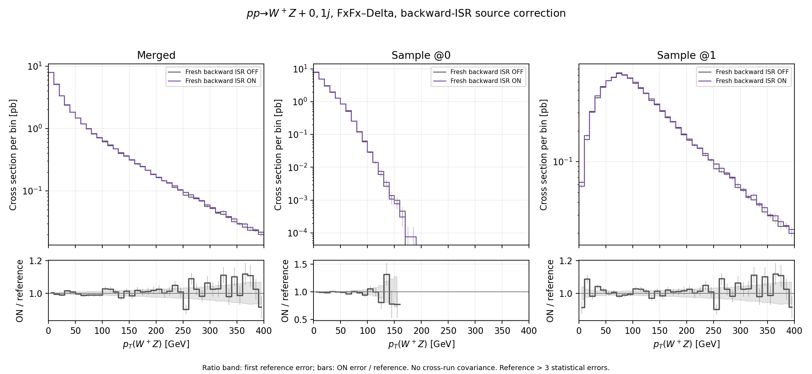
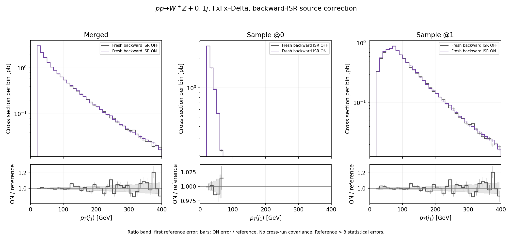
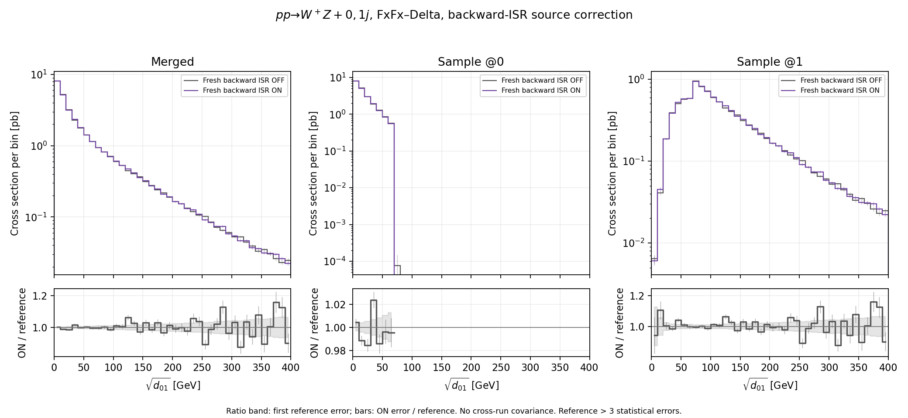

# WZ FxFx-Delta backward-ISR comparison

The primary comparison uses `p p > w+ z [QCD] @0` and `p p > w+ z j [QCD] @1`, with geometric-mean H-event scales in both samples. The backward-ISR source switch is off in the reference and on in the new sample. Source changes require fresh integration and generation; absolute rates retain each run’s own normalization.

The correction uses the active Delta table’s coupling and running: `alpha_s(MZ)=0.1365`, one-loop for the shipped provider. This is local to the no-emission probability; the hard matrix elements, hard PDFs and analytic FxFx factors keep their existing coupling settings. The shower’s retained `alpha_s(MZ)=0.118` is a separate setting and does not override the source correction. The table profile is an audited archive identification; its original producing log is unavailable.

## Absolute merged rates

| Sample | Fresh backward ISR OFF (pb) | Fresh backward ISR ON (pb) | ON/OFF change |
| --- | ---: | ---: | ---: |
| @0 | 20.929782 ± 0.042567 | 20.881391 ± 0.042666 | -0.231% |
| @1 | 10.008458 ± 0.032694 | 10.098387 ± 0.032787 | +0.899% |
| Merged | 30.938241 ± 0.053674 | 30.979777 ± 0.053809 | +0.134% |

Errors are each HwU run’s reported conditional event/shower sampling errors at the estimated source normalization. The separate source integration-normalization errors shown below are not propagated into these rate errors or the plot bands. No cross-run covariance or error on a difference/ratio is estimated. The binned-integral errors below combine the reported bin errors in quadrature; bin covariance is unavailable.

## Source normalization and event signs

| Sample | Events | Integrated signed rate (pb) | Negative before shower | Negative after merging |
| --- | ---: | ---: | ---: | ---: |
| Fresh backward ISR OFF | 1,000,000 | 49.466075 ± 0.114470 | 17.5884% | 8.9641% |
| Fresh backward ISR ON | 1,000,000 | 49.551454 ± 0.067357 | 17.6073% | 8.9857% |

The integration errors in the signed-rate column are a separate source-normalization uncertainty. They are not part of the conditional HwU/bin errors or ratio bands. No combined uncertainty or significance for the ON/OFF difference is assigned.

Accepted positive/negative counts are inferred only when all LHE absolute weights are equal and the signed HwU rate reproduces integer counts within its rounding precision. The JSON retains separate pre-shower signs for every sample and S/H event type.

| Sample/type | OFF events | ON events | OFF median SCALUP (GeV) | ON median SCALUP (GeV) |
| --- | ---: | ---: | ---: | ---: |
| @0 S | 292,737 | 291,189 | 81.716555 | 81.723284 |
| @0 H | 99,822 | 101,091 | 86.624283 | 85.592010 |
| @1 S | 522,082 | 522,460 | 27.316572 | 27.318107 |
| @1 H | 85,359 | 85,260 | 14.411882 | 14.440093 |

Event populations and weights can change under the source correction. No common-event or unchanged-weight assumption is made.

## WZ transverse-momentum integrals

| Sample | Range (GeV) | OFF (pb) | ON (pb) | Change |
| --- | ---: | ---: | ---: | ---: |
| @0 | 0–10 | 7.854428 ± 0.025667 | 7.883306 ± 0.025794 | +0.368% |
| @0 | 10–20 | 4.931056 ± 0.020602 | 4.890765 ± 0.020567 | -0.817% |
| @0 | 20–70 | 7.650534 ± 0.026142 | 7.616205 ± 0.026211 | -0.449% |
| @0 | 70–150 | 0.492387 ± 0.006721 | 0.489889 ± 0.006708 | -0.507% |
| @1 | 0–10 | 0.062895 ± 0.002568 | 0.057422 ± 0.002399 | -8.702% |
| @1 | 10–20 | 0.164919 ± 0.004251 | 0.179549 ± 0.004393 | +8.871% |
| @1 | 20–70 | 2.542485 ± 0.016789 | 2.570730 ± 0.016818 | +1.111% |
| @1 | 70–150 | 4.422391 ± 0.021782 | 4.426712 ± 0.021763 | +0.098% |
| Merged | 0–10 | 7.917323 ± 0.025795 | 7.940728 ± 0.025905 | +0.296% |
| Merged | 10–20 | 5.095975 ± 0.021036 | 5.070314 ± 0.021031 | -0.504% |
| Merged | 20–70 | 10.193019 ± 0.031069 | 10.186934 ± 0.031142 | -0.060% |
| Merged | 70–150 | 4.914778 ± 0.022795 | 4.916601 ± 0.022774 | +0.037% |

## Shower checks and distributions

| Sample | Tried / selected | Accepted | Errors or unexpected aborts |
| --- | ---: | ---: | ---: |
| Fresh backward ISR OFF | 1,000,000 / 1,000,000 | 493,268 | 0 |
| Fresh backward ISR ON | 1,000,000 / 1,000,000 | 492,625 | 0 |

All histograms satisfy the checked `SUM = @0 + @1` tolerance. Expected end-of-file messages are excluded from unexpected aborts; the JSON retains warnings and sample-specific shower counts.

[Primary three-page PDF](distributions.pdf) and [all histogram bins](histogram_comparison.csv). Plots retain absolute cross sections. Ratio bands show the reference relative error and bars show the ON error divided by the reference central value. Ratios omit bins whose reference is below three statistical errors. Negative/nonpositive bins remain in the CSV.







## Actual shower steering

The primary samples have identical observed physics-setting values across all shower shards.

## Historical comparisons

These compare complete run epochs. In particular, historical steering omitted an explicit `TimeShower:QEDshowerByOther` setting, while the fresh samples use the corrected QED-off switch. Historical differences cannot be attributed exclusively to the backward-ISR source correction. Their original source normalizations and steering differences are retained in JSON.

| Historical reference | @0 rate (pb) | @1 rate (pb) | Merged rate (pb) | ON/merged change |
| --- | ---: | ---: | ---: | ---: |
| Previous geometric mean | 20.924817 ± 0.042615 | 10.121129 ± 0.032874 | 31.045946 ± 0.053821 | -0.213% |
| Original hard scalar | 20.886361 ± 0.042526 | 10.073250 ± 0.032801 | 30.959611 ± 0.053707 | +0.065% |

| Historical reference | Negative before shower | Negative after merging | Median H SCALUP @0 / @1 (GeV) |
| --- | ---: | ---: | ---: |
| Previous geometric mean | 17.6135% | 8.9482% | 86.634489 / 14.363820 |
| Original hard scalar | 17.6162% | 8.8874% | 154.616000 / 25.808998 |

[Historical spectrum comparisons](historical_distributions.pdf).

## Assessment

The observed total-rate and broad merged-spectrum changes are modest, giving a reasonable implementation check for this fixed setup. The comparison does not demonstrate a reduction of negative-weight fractions.

The central negative fractions change by +0.0189 percentage points before showering and +0.0216 points after merging. These shifts do not support a negative-weight reduction claim. Source integration uncertainty and the unavailable cross-run covariance limit interpretation of the small rate changes.

This numerical check establishes neither an exact or universal NLO-matching theorem nor logarithmic accuracy or exact competing-shower correspondence.

## Inputs and reproduction

The [complete 15-page comparison book](plots/full_comparison.pdf) and
[plot index](plots/README.md) extend the initial figures to all six saved
linear/logarithmic spectra, native ranges through 1 TeV, low-scale views,
rebinned tails, and S/H source SCALUP. Each page overlays all four
prescriptions and separates the historical geometric/hard and fresh
backward-ISR on/off ratios.

Over 400--1000 GeV, the fresh ON/OFF merged central integrals change by
+5.26% for pT(WZ), +8.39% for leading-jet pT and +8.10% for sqrt(d01).
Those effects were outside the initial 0--400 GeV plots. Their absolute
rates are small, the observables are correlated, and conditional sampling
errors plus separate source integration uncertainty limit interpretation.
The log spectra also reveal an ultrasoft historical/fresh difference in
WZ recoil; historical charged-resonance QED steering differs, so this
cannot be assigned to one source or H-scale change. The inclusive-rate
agreement should not be read as unchanged distributions in every region.

Each run audit records the LHE/HwU hashes, source and card hashes, banner hashes, saved integration totals and actual shower steering. [Setup](setup.json), when supplied, records the generation commands and source snapshot. [Full comparison](comparison.json) retains all scale quantiles, signs, rates and spectrum integrals.

```sh
/usr/bin/python3 fxfx_diagnostics/compare_wz_backward_isr.py --reference-process PROC_pp_wz01j_EWjets_Delta_BackwardOFF --reference-run run_backward_off --new-process PROC_pp_wz01j_EWjets_Delta_BackwardON --new-run run_backward_on --historical PROC_pp_wz01j_EWjets_Delta_Hgeom run_hgeom 'Previous geometric mean' --historical PROC_pp_wz01j_EWjets_Delta run_01 'Original hard scalar' --historical-audit docs/audits/fxfx_delta_wz_h_scales/comparison.json --historical-audit docs/audits/fxfx_delta_wz_h_scales/comparison.json --historical-steering docs/audits/fxfx_delta_wz_h_scales/cards/new_Pythia8.cmd --historical-steering docs/audits/fxfx_delta_wz_h_scales/cards/old_Pythia8.cmd --setup docs/audits/fxfx_delta_wz_backward_isr/setup.json
```

This fixed setup tests the implemented source prescription. It does not establish exact competing-shower agreement or logarithmic accuracy of the combined FxFx–Delta scheme.
