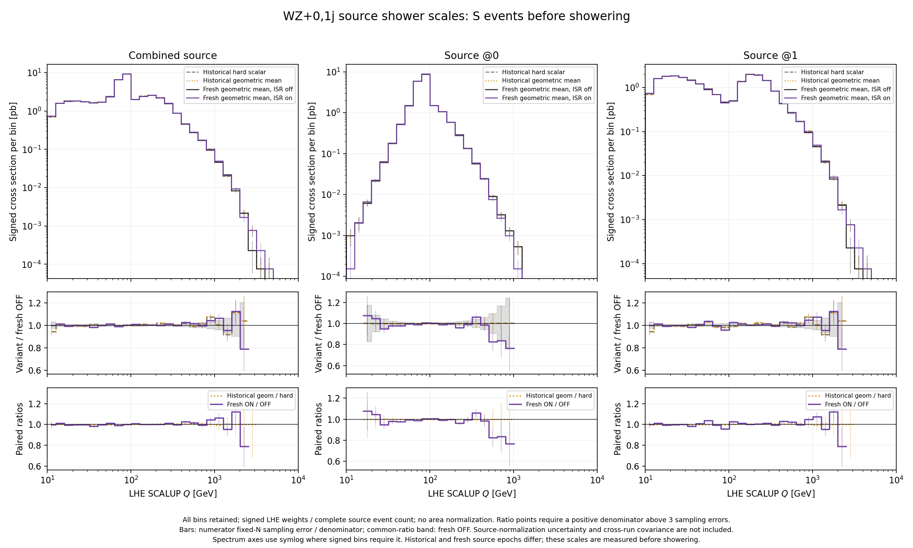
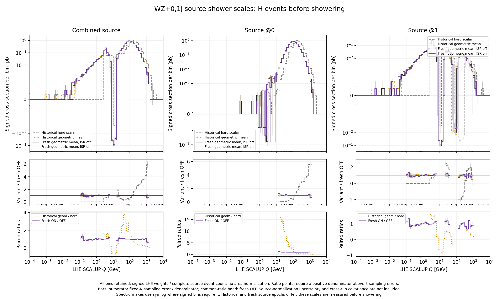

# Source shower-scale comparisons

[Two-page PDF](source_scales.pdf): S- and H-event LHE SCALUP, before showering,
with combined, @0 and @1 sources. Every retained event enters the plotted
logarithmic support. The four source epochs are overlaid, with a common fresh
backward-ISR-off denominator and the historical geometric-mean/hard-scale and
fresh backward-ISR-on/off paired ratios.

These are absolute signed source cross sections per logarithmic bin, obtained
from the original LHE weight divided by the **entire** source event count.
There is no normalization to S/H counts, multiplicity counts, survivors or
unit area. Fixed-source-count sampling errors are
`sqrt(max(sum(w²) - sum(w)²/N, 0)/(N*(N-1)))`, with the **complete** source
count `N`. Source integration-normalization errors are reported separately
in comparison.json and are not propagated here. Cross-run and bin
covariances are unavailable. Ratio points require a positive
reference bin above three conditional sampling errors. Signed bins remain
visible with a symmetric-logarithmic axis when needed.

Historical comparisons include different source epochs; the old shower QED
setting does not enter these pre-shower scale distributions. The source-scale
prescription is unchanged by the backward-ISR switch, but changed weights and
event populations can change its sampled distribution.





[Bin data](source_scales.csv), [hashes and integral checks](source_scales.json).

```sh
python3 fxfx_diagnostics/plot_wz_source_scales.py
```
