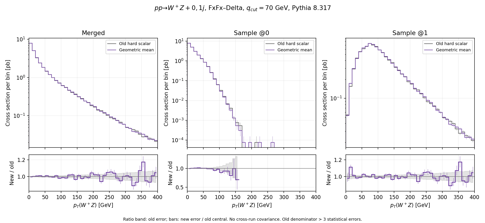
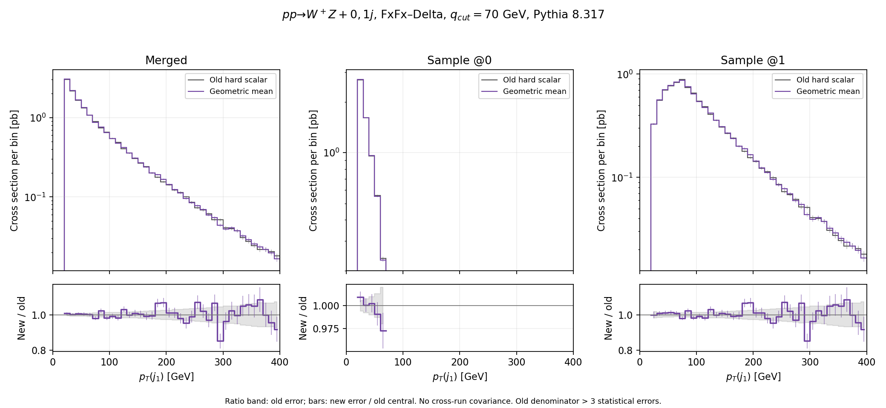
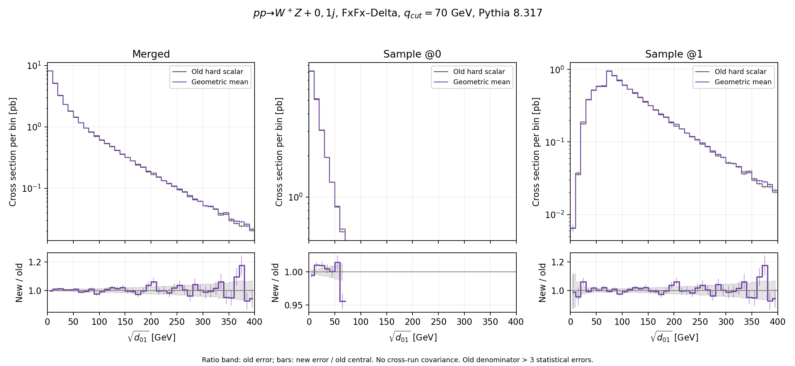

# WZ FxFx Delta comparison of H-event shower scales

The old hard scalar and the geometric mean were compared with one million events each for `p p > w+ z [QCD] @0` and `p p > w+ z j [QCD] @1`.

Both runs use 13 TeV beams, the same model and physics cards, `ptj=10` GeV, `Qcut=70` GeV, maximum merged multiplicity one, stable W/Z bosons, and Pythia 8.317 with MPI, hadronization and primordial transverse momentum disabled and `qed_shower=F`. The archived steering did not explicitly disable `TimeShower:QEDshowerByOther`; this comparison predates that switch fix and does not establish the absence of charged-resonance QED radiation. The original integration grids and Fortran seed 33 were reused. The integration normalization is therefore shared; this is a test of event generation and showering, rather than an independent redetermination of the NLO integral.

The baseline is commit `a4d369829a647ace3d8b87e1466593062c197f2f`. [The source patch](source.patch), [setup and hashes](setup.json), and [effective cards](cards/) record the comparison inputs.

## Merged rates

| Sample | Old scalar (pb) | Geometric mean (pb) | Change |
| --- | ---: | ---: | ---: |
| @0 | 20.886361 ± 0.042526 | 20.924817 ± 0.042615 | +0.184% |
| @1 | 10.073250 ± 0.032801 | 10.121129 ± 0.032874 | +0.475% |
| Merged | 30.959611 ± 0.053707 | 31.045946 ± 0.053821 | +0.279% |

Errors are the statistical errors reported by each HwU run. The samples share integration information and many hard events; no cross-run covariance or uncertainty on their difference is estimated.

## Event and scale audit

The negative-weight fractions before showering are 17.6162% (old) and 17.6135% (new). The comparison matched 996,763 unique physical records by particle data and S/H type, with 0 changed weights among them. The Python allocation of event counts to integration jobs can differ despite the same Fortran seed, so identical event order is not assumed.

| Sample | Median old H scale (GeV) | Median new H scale (GeV) | Common S records with changed scale |
| --- | ---: | ---: | ---: |
| @0 | 154.616000 | 86.634489 | 0 / 291,766 |
| @1 | 25.808998 | 14.363820 | 0 / 520,397 |

The H scale is the unweighted geometric mean of positive directed H-event starts mapped from the stopping scales. Diagonal and nonpositive entries are excluded. The selected outer flow and fold own the scalar, with no Born hard-scale floor. The ordinary FxFx fallback is retained where no Delta stopping scales were reconstructed. This scalar approximation does not reproduce competition with separate directed limits.

## Shower and histogram checks

| Prescription | Selected LHE records | Accepted after shower and merging | Pythia errors or unexpected aborts |
| --- | ---: | ---: | ---: |
| Old scalar | 1,000,000 | 491,504 | 0 |
| Geometric mean | 1,000,000 | 493,605 | 0 |

The negative-weight fractions among accepted merged events are 8.8874% (old) and 8.9482% (new). These counts are inferred from the accepted totals and signed rates after checking that the LHE absolute weights are uniform; the HwU rounding is consistent with integer positive and negative counts.

Each histogram was checked bin by bin for `SUM = @0 + @1`. The maximum relative residuals are 1.15e-07 (old) and 1.37e-07 (new). Expected end-of-file messages are excluded from the abort count; all warning counts are retained in the JSON audits.

## Distributions

[Three-page comparison PDF](distributions.pdf): merged, @0 and @1 spectra with per-run statistical errors and new/old ratios. The ratio band shows the old relative statistical error, and ratio bars show the new error divided by the old central value; they do not include a cross-run covariance. Plots show 0–400 GeV; the [CSV](histogram_comparison.csv) contains every bin. Ratios omit bins whose old denominator is below three statistical errors.







## Reproduction

The generation and shower commands are recorded in `setup.json`. The original workflow audit stopped on the banner tag `scalesfunctionalform`; this audit checks scale tags only inside event records. Once the old and new run outputs are available, run from the checkout root:

```sh
python3 fxfx_diagnostics/compare_wz_h_scales.py
```

[Full numerical comparison](comparison.json), [old audit](old_audit.json), [new audit](new_audit.json).
